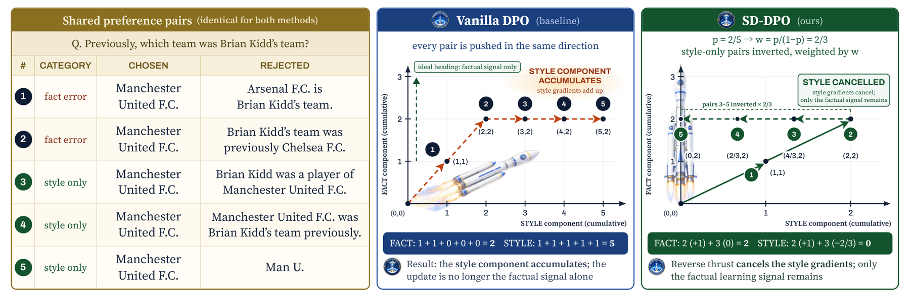

# Style-Debiased DPO: Updating LLM Knowledge with Factuality-Aware Synthetic Preference Data

<!-- source-sha256: f73b4f40fdc7d775d0d659d24a1245415c5a49c8af3e97d0bde750bc715267cb -->

[简体中文](README.md)

> **L1 core-mechanism diagnostic.** Implements preference reversal and a group-balanced loss; factuality scores come from fixtures, not an LLM judge.

## Paper information

| Field | Details |
|---|---|
| Paper | [Style-Debiased DPO](https://arxiv.org/abs/2609.16532) |
| Organization | First-author affiliation: Waseda University |
| First public release | 2026-09-15 (arXiv v1) |
| Authors' code | No public author repository was found as of 2026-09-16. |
| Adapter / method | `sd-dpo` |
| Local reproduction code | [`src/auto_research/post_training/latest_20260916_followup.py`](https://github.com/daiwk/auto-research/blob/main/src/auto_research/post_training/latest_20260916_followup.py) |

## Original paper

### Motivation and method

Identify rejected responses that are factually correct but stylistically different, reverse their preference direction, and weight groups proportionally to cancel the style gradient.

~~~mermaid
flowchart LR
  I[Public input and current state] --> M[SD-DPO mechanism]
  M --> A[Auditable intermediates]
  A --> O[Output or state update]
~~~

<!-- paper-figure:start -->
### Key figure from the paper

> **Figure 1:** Method overview and components. From the [original paper](https://arxiv.org/abs/2609.16532); copyright remains with the authors.
<!-- paper-figure:end -->

### Core computation and code mapping

The reference kernel preserves the decisive ranking, gates, preference direction, credit weights, or state transitions and exposes auditable statistics. Three-seed fixtures test invariants and edge cases, not paper capability.

### Paper results

Accuracy, speed, training loss, and benchmarks are original paper results only. Local results are not directly compared or extrapolated to online gains.

## Local reproduction

See the [three-seed artifact](metrics/mechanism-seeds42-44.json). The common receipt marks `diagnostic_only=true`, ineligible for formal capability ranking.

## Reproduction boundaries

The local path executes preference reversal and group-balanced loss. Fixture factuality scores do not stand in for a real LLM judge.
