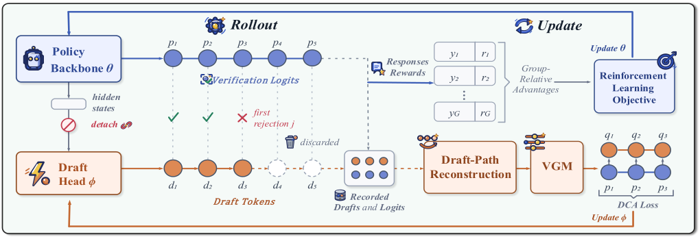

# GrowMTP: Can RL Grow Its Own Draft Head?

<!-- source-sha256: cae3393592dfc571ce29580432cc8389c8bd9b42f92865bd323b9f6cbc19e74e -->

[简体中文](README.md)

> **L1 mechanism diagnostic.** Depth-coupled acceptance loss, without demonstrated GPU speedup.

## Paper information

| Field | Value |
| --- | --- |
| Paper | [GrowMTP: Can RL Grow Its Own Draft Head?](https://arxiv.org/abs/2609.16648) |
| Affiliations | WeChat AI, Tencent / Peking University |
| First public release | 2026-09-15 (arXiv v1) |
| Authors' code | No public author repository found as of 2026-09-16. |
| Adapter / method | `growmtp` |
| Local code | [`src/auto_research/post_training/latest_20260916.py`](https://github.com/daiwk/auto-research/blob/main/src/auto_research/post_training/latest_20260916.py) |

## Original paper

### Background and contribution

During RL rollouts, train the multi-token prediction head by accepted draft depth and decouple its gradient from the backbone.

<!-- paper-figure:start -->
### Key figure from the paper

Original Figure 2: rollout and draft-head training. From the [paper](https://arxiv.org/abs/2609.16648); copyright belongs to the authors. Not a local result.
<!-- paper-figure:end -->

### Core mechanism

The reference retains decisive gating, weighting, and state changes, exposing depth and other auditable quantities. Fixed budget and three seeds test invariants, not paper-scale training.

### Paper results

Paper results on speed, cost, and capability remain separate from local measurements.

## Local reproduction

[Three-seed results](metrics/mechanism-seeds42-44.json) are `diagnostic_only=true` and do not enter the public dashboard as full capability gains.

## Reproduction limits

Only acceptance loss was validated; no GPU speedup claim.
