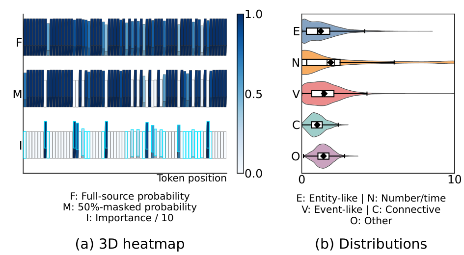

# TIAO: Token Importance-Aware Policy Optimization for Text Summarization

<!-- source-sha256: 5957cb262e34f3e8ef0d6479f2d1313f242dba01a9cb1389691512310ee27aaf -->

[简体中文](README.md)

> **L1 core-mechanism diagnostic.** Executes token dependency and two-scale credit, not 7B model training.

## Paper information

| Field | Details |
|---|---|
| Paper | [TIAO: Token Importance-Aware Policy Optimization for Text Summarization](https://arxiv.org/abs/2609.16748) |
| Organization | First-author affiliation: National University of Defense Technology |
| First public release | 2026-09-15 (arXiv v1) |
| Authors' code | [Public implementation](https://github.com/TechCloud-x/TIAO) |
| Adapter / method | `tiao` |
| Local reproduction code | [`src/auto_research/post_training/latest_20260916_followup.py`](https://github.com/daiwk/auto-research/blob/main/src/auto_research/post_training/latest_20260916_followup.py) |

## Original paper

### Motivation and method

Estimate dependency from changes in token probabilities before and after masking the source document, then reshape trajectory advantages and concentrate updates on important tokens.

~~~mermaid
flowchart LR
  I[Public input and current state] --> M[TIAO mechanism]
  M --> A[Auditable intermediates]
  A --> O[Output or state update]
~~~

<!-- paper-figure:start -->
### Key figure from the paper

> **Figure 1:** Overall method and components. From the [original paper](https://arxiv.org/abs/2609.16748); copyright remains with the authors.
<!-- paper-figure:end -->

### Core computation and code mapping

The reference kernel preserves the decisive ranking, gating, preference direction, credit weighting, or state transitions and exposes auditable statistics. Three-seed fixtures check invariants and edge cases, not paper capability.

### Paper results

Accuracy, speed, training loss, and benchmarks are original paper results only. Local results are not directly compared with them or extrapolated to online gains.

## Local reproduction

See the [three-seed results](metrics/mechanism-seeds42-44.json). The common receipt marks `diagnostic_only=true`, ineligible for formal capability ranking.

CUDA ran on an NVIDIA A100; see the [sanitized GPU receipt](../../gpu-validations/tiao-a100-20260916.json). The receipt omits hostnames, SSH aliases, and driver/build strings.

## Reproduction boundaries

Token dependency and two-scale credit are implemented locally. No 7B model was trained.
