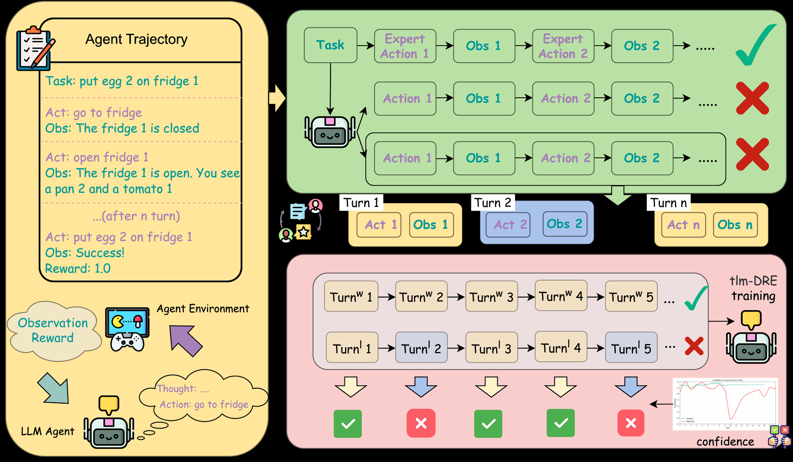

# Turn-level Multiscale Density Ratio Estimation for LLM Agents

<!-- source-sha256: 2f863944828fabe754076ae3f1746326bc7b45643dc422a0cdd9527f8d035ad3 -->

[简体中文](README.md)

> L1 turn weighting and asymmetric token updates, not a live multi-turn agent environment.

## Paper information

| Field | Details |
|---|---|
| Paper | [Turn-level Multiscale Density Ratio Estimation for LLM Agents](https://arxiv.org/abs/2609.16760) |
| Institution | Alibaba Group (first author). |
| First public release | 2026-09-15 (arXiv v1) |
| Author code | No public author repository found as of 2026-09-16. |
| Local adapter or method key | `tlm-dre` |
| Local reproduction code | [`src/auto_research/post_training/latest_20260916.py`](https://github.com/daiwk/auto-research/blob/main/src/auto_research/post_training/latest_20260916.py) |

## Paper method and evidence

Allocate weights at multiple scales by conversation turn, and use asymmetric token updates for positive and negative density ratios.

<!-- paper-figure:start -->
### Original paper figure

Figure 1 shows the multiscale credit path. From the [original paper](https://arxiv.org/abs/2609.16760); copyright remains with the authors.
<!-- paper-figure:end -->

### Core equation

Local reference exposes weights and state transitions so adjacent methods can be compared under the same fixture budget.

### Reported results

Paper capability, speed, and cost claims are not local effects or online projections.

## Local reproduction

[Three-seed mechanism results](metrics/mechanism-seeds42-44.json) are diagnostic_only=true. Fixed-budget fixtures verify the defining operator and auditable intermediate states; they are not a benchmark, production result, or capability-ranking entry.
