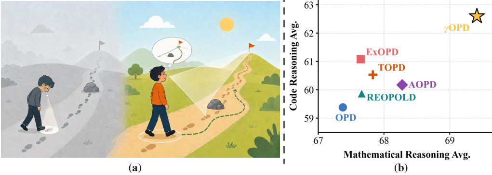

# Beyond Token-Local Imitation: Reward-Compatible Temporal Credit Assignment for On-Policy Distillation

<!-- source-sha256: f82ebd84814723fa557a23c6e686eda9ad0931a594831e9b464485e45d1df4e2 -->

[简体中文](README.md)

> **L1 mechanism diagnostic.** Discounted credit and RBM execute; no paper-scale training.

## Paper information

| Field | Value |
| --- | --- |
| Paper | [Beyond Token-Local Imitation: Reward-Compatible Temporal Credit Assignment for On-Policy Distillation](https://arxiv.org/abs/2609.16937) |
| Affiliations | Tsinghua University / DiDi Voyager Labs |
| First public release | 2026-09-15 (arXiv v1) |
| Authors' code | No public author repository found as of 2026-09-16. |
| Adapter / method | `gamma-opd` |
| Local code | [`src/auto_research/post_training/latest_20260916.py`](https://github.com/daiwk/auto-research/blob/main/src/auto_research/post_training/latest_20260916.py) |

## Original paper

### Background and contribution

Approximate sequence-level reverse KL with discounted temporal credit and add verifiable outcomes through bounded reward advantages.

<!-- paper-figure:start -->
### Key figure from the paper

Original Figure 1: temporal credit assignment. From the [paper](https://arxiv.org/abs/2609.16937); copyright belongs to the authors. Not a local result.
<!-- paper-figure:end -->

### Core mechanism

The reference preserves defining gates, weights, and state changes with auditable intermediates for matched-budget comparison. Three fixed-budget seeds test invariants, not paper-scale training.

### Paper results

The paper's capability, speed, and cost findings are not local evidence or production gains.

## Local reproduction

[Three-seed metrics](metrics/mechanism-seeds42-44.json) are `diagnostic_only=true`, not dashboard capability gains.

## Reproduction limits

Discounted credit propagation and RBM only; no paper-scale LM training.
