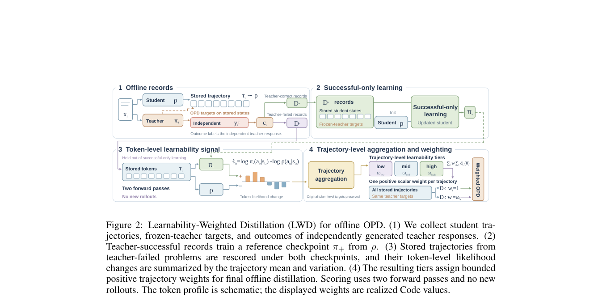

<!-- source-sha256: 3a5ccea4dbcb4f0c835f0239dd0af3d7d1367650ca40d9b641828579043ec9ef -->

[简体中文](README.md) · English

# Trajectory Learnability for Offline On-Policy Distillation

> **L1 core mechanism diagnostic.** Per-token learnability aggregation and trajectory weighting run. The paper's GPU training budget was not reproduced.

## Paper information

| Field | Details |
|---|---|
| Paper | [Trajectory Learnability for Offline On-Policy Distillation](https://arxiv.org/abs/2609.18321) |
| Institution | National University of Singapore (first author affiliation) |
| First public release | 2026-09-16 (arXiv v1) |
| Original source code | No public author repository found as of 2026-09-19. |
| Adapter/method | `trajectory-learnability` |
| Local reproduction code | [`src/auto_research/post_training/latest_20260919.py`](https://github.com/daiwk/auto-research/blob/main/src/auto_research/post_training/latest_20260919.py) |

## Original paper summary

### Background and main changes

Train a reference model on successful trajectories. Changes in per-token log likelihood between that reference and the current policy estimate learnability, which reweights offline OPD trajectories.

<!-- paper-figure:start -->
### Key figure from the paper

> **Figure 2:** Overall design and components. From the [paper](https://arxiv.org/abs/2609.18321); copyright belongs to the authors. Click for the source.
<!-- paper-figure:end -->

### Core mechanism

The local reference kernel retains defining gates, weights, state transitions or scheduling rules and writes intermediates to metrics. See implementation functions and test invariants for variables and formulas.

### Offline and online results

The paper's deployment, benchmark, training-efficiency and inference-speed figures are author results. The [local three-seed artifact](metrics/mechanism-seeds42-44.json) checks mechanisms, shapes and state invariants, not paper-scale performance.

## Scope

Per-token learnability aggregation and trajectory reweighting run locally. The paper's GPU budget was not reproduced.
