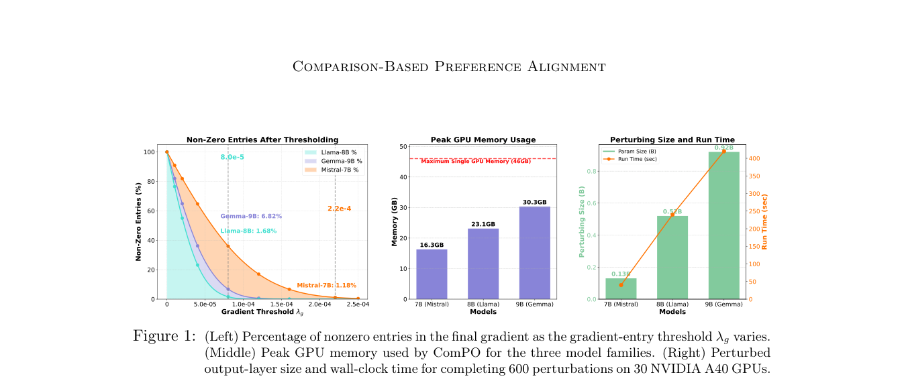

# ComPO: A Zeroth-Order Paradigm for LLM Preference Alignment

<!-- source-sha256: 094da0195267e05c6b67413d6cb53a92aff3c87b74d8c6d0be6f31b0ccbd8cda -->

[简体中文](README.md)

> L1 one-bit comparison oracle and thresholded update; not an LLM alignment result.

## Paper information

| Field | Details |
|---|---|
| Paper | [A Zeroth-Order Paradigm for LLM Preference Alignment](https://arxiv.org/abs/2609.19144) |
| Institution | University of California, Berkeley (first author). |
| First public release | 2026-09-16 (arXiv v1) |
| Author code | No public author implementation found as of 2026-09-19. |
| Local adapter or method key | `compo` |
| Local reproduction code | [`src/auto_research/post_training/latest_20260919.py`](https://github.com/daiwk/auto-research/blob/main/src/auto_research/post_training/latest_20260919.py) |

## Paper method and evidence

Compare outcomes at positive and negative parameter perturbations instead of differentiating the preference objective. The comparison returns one bit of direction, and coordinate-wise thresholding suppresses noise.

<!-- paper-figure:start -->
### Original paper figure

Figure 1 illustrates the zeroth-order update. From the [original paper](https://arxiv.org/abs/2609.19144); copyright remains with the authors.
<!-- paper-figure:end -->

### Core equation

The reference records direction and update statistics. See implementation and invariant tests for the variable mapping.

### Reported results

Paper benchmark, efficiency, or inference claims are not local measurements.

## Local reproduction

The [three-seed reference tests](metrics/mechanism-seeds42-44.json) check the operator, shapes, boundaries, and state invariants under a fixed fixture budget. These are `diagnostic_only=true`, not paper-scale outcomes or online gains.
