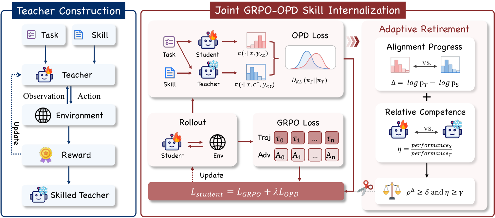

# RetireOPD: Self-Retiring On-Policy Distillation for Agentic Reinforcement Learning

<!-- source-sha256: c29be7075f340294f57e8dd204c0d0ab6d4cb5e4415c52b81ddb3eb0105ad978 -->

[简体中文](README.md)

> **L1 core-mechanism diagnostic.** Runs the retirement rule and student updates, not paper-scale agent-teacher training.

## Paper information

| Field | Details |
|---|---|
| Paper | [RetireOPD: Self-Retiring On-Policy Distillation for Agentic Reinforcement Learning](https://arxiv.org/abs/2609.20784) |
| Organization | First-author affiliation: Zhejiang University |
| First public release | 2026-09-17 (arXiv v1) |
| Authors' code | [ZJU-REAL/SDAR](https://github.com/ZJU-REAL/SDAR) is public. |
| Adapter / method | `retire-opd` |
| Local reproduction code | [`src/auto_research/post_training/latest_20260919.py`](https://github.com/daiwk/auto-research/blob/main/src/auto_research/post_training/latest_20260919.py) |

## Original paper

### Motivation and method

Assign separate teachers to skills. The student combines RL and on-policy distillation, automatically retiring a teacher once success approaches the teacher's and the distribution gap stops narrowing.

~~~mermaid
flowchart LR
  I[Public input and current state] --> M[retire-opd mechanism]
  M --> A[Auditable intermediates]
  A --> O[Output or state update]
~~~

<!-- paper-figure:start -->
### Key figure from the paper

> **Figure 3:** Training pipeline and key optimization steps. From the [original paper](https://arxiv.org/abs/2609.20784); copyright remains with the authors. Click the image for the source.
<!-- paper-figure:end -->

### Core computation

The local reference kernel preserves the paper's decisive gates, weights, state transitions, or scheduling rules and records intermediates in the metrics artifact. Implementation functions and invariant assertions in tests map the formulas and variables.

### Paper results

Reported online results, benchmarks, training efficiency, or inference speed are original paper results. The local [three-seed artifact](metrics/mechanism-seeds42-44.json) checks core mechanisms, shapes, and state invariants without comparing directly to the paper's numbers.

## Reproduction boundaries

The retirement criterion and student update execute locally. The paper-scale agent teachers were not trained.
