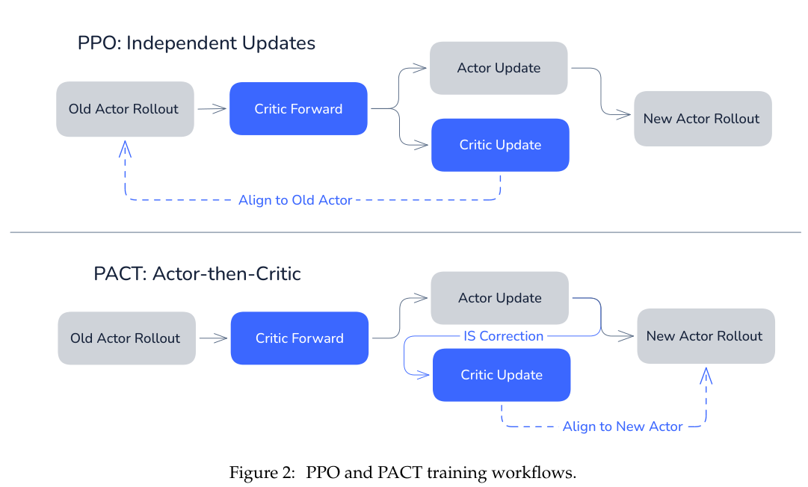

# PACT: From token credit assignment to critic alignment

<!-- source-sha256: 9b959e06f2497914ef5d46790f98be144280136627e3caaa6b90fbadf30e75e6 -->

[简体中文](README.md)

> Genuine free-generation mechanism test of Actor-then-Critic, new-policy importance correction, and a probabilistic critic; not paper-scale LLM evidence.

## Paper information

| Field | Details |
|---|---|
| Paper | [PACT: From Credit Assignment to Critic Alignment](https://arxiv.org/abs/2609.26355) |
| Institution | AllSpark Team; individual first-author affiliation is not listed. |
| First public release | 2026-09-22 (arXiv v1) |
| Author code | The [project repository](https://github.com/AllSpark-Research/PACT) was empty as of 2026-09-27; no training source was released. |
| Local adapter or method key | `pact` |
| Local reproduction code | `src/auto_research/post_training/pact.py`, `src/auto_research/post_training/generation.py` |

## Paper method and evidence

Completeness, prefix consistency, and neutrality characterize token credit as the difference between adjacent conditional prefix expectations. A probabilistic critic estimates prefix value so token advantage can approximate `R − V(prefix)`. Update the actor first so the critic targets the updated policy. Using a current-token ratio rather than the product over the remaining sequence is a first-order approximation, not exact continuation importance sampling.

<!-- paper-figure:start -->
### Original paper figure

Figure 2 shows the actor/critic update sequence. From the [original paper](https://arxiv.org/abs/2609.26355); copyright remains with the authors.
<!-- paper-figure:end -->

### Core equation

$$
\rho_t = \exp\!\left(\log\pi_{\rm new}(y_t\mid x,y_{<t})-\log\pi_{\rm old}(y_t\mid x,y_{<t})\right),
\qquad Y_t=\rho_t R.
$$

The critic loss for logit z_t is softplus(z_t) − Y_t z_t. A target can exceed 1, so do not use a BCE API restricted to [0,1]. Filter ratios to the paper's interval and average accepted tokens.

### Reported results

The authors use Qwen3.5-4B for math (72.87% average across four benchmarks) and Qwen3.6-35B-A3B for SWE-bench Verified (67.4% pass@1). These are not local results.

## Local reproduction

A tiny causal GRU and independent prefix critic run unconstrained generation and an exact-answer verifier. Warm up with train-only reference solutions and derive the character vocabulary from training text. During PACT, the actor sees train prompts and sampled tokens only; gold is external-verifier-only, never actor or critic input. Validation and test stay separate. Use the allowed clipped PPO variant, then train the critic from new/rollout token ratios.

~~~bash
auto-research post-train --algorithm pact --dataset arithmetic-generate \
  --maximum-examples 48 --steps 3 --group-size 2 --seeds 42,43,44 \
  --offline --device cpu --cpu-threads 2
~~~

Three seeds move validation exact accuracy from 0.0000 to 0.0069 ± 0.0098 and mean verifier reward from 0.1000 to 0.1056. Relative gain is undefined for the zero baseline; format hit rate remains zero and very few answers are correct. Record critic acceptance, updated ratios, and critic loss; tests assert both parameter sets actually change. [Command, seeds, fingerprints, and results](../../experiments/pact-arithmetic-seeds42-44.json). No 4B/35B checkpoint run, tool environment, original training scale, or benchmark result.
