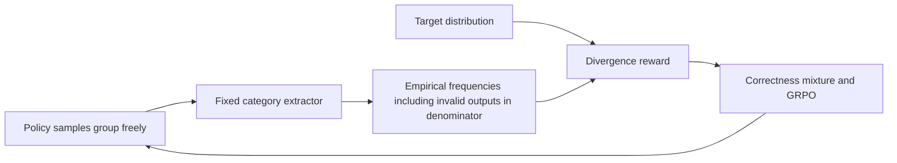
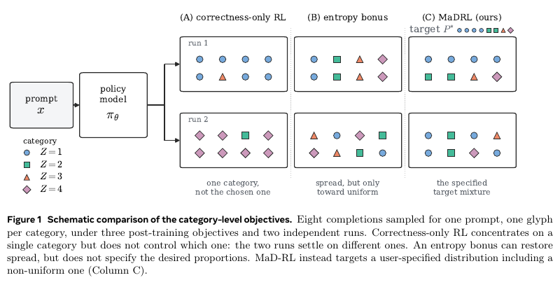

# MaD-RL: Matching Category Distributions with Reinforcement Learning

<!-- source-sha256: 514b41631c946ddab798bb2b4728f72a2a84ecf4fb5422dba47bae82c71a36ef -->

[简体中文](README.md)

> Google/Meta priority reference linked to existing experiments. **Full study too costly; not reproduced (review DONE).** Mechanism evidence is not original math/code capability.

## Paper information

| Field | Value |
| --- | --- |
| Paper | [arXiv 2609.31644](https://arxiv.org/abs/2609.31644); [Meta publication](https://ai.meta.com/research/publications/mad-rl-matching-distributions-for-calibrating-llms-with-reinforcement-learning/) |
| Affiliation | First author Sourabh Kulkarni, Meta Superintelligence Labs |
| First public release | 2026-09-12 11:12:59 UTC, arXiv v1. Meta catalog date is September 24; PDF date does not override submission. |
| Authors' code | No release found in checked paper and official sources; unrelated robotics MAD is not this implementation. |
| Adapter/key | `adapter: null`; reference/existing CLI `mad-rl`; separate GPU diagnostic `mad-rl-qwen-choice` |
| Local code | Existing `src/auto_research/post_training/mad_rl.py` and `scripts/mad_rl_qwen_choice.py`; unchanged |

## Original paper

### Background and contribution

Per-example correctness can collapse output categories. MaD-RL matches category frequency to a target, rather than merely raising token entropy. L2, forward KL, reverse KL, or JSD rewards derived from group frequencies combine with correctness for GRPO. Measure distribution fit and accuracy separately. See [Section 2](https://arxiv.org/html/2609.31644v1#S2).

<!-- paper-figure:start -->
### Key figure from the paper

Original page 2 compares correctness, entropy, and target distribution matching. From the [paper](https://arxiv.org/abs/2609.31644); copyright belongs to the authors, not a local result.
<!-- paper-figure:end -->

### Core equations

For empirical $p$ and target $q$, rewards are `q_z-p_z` (L2), `q_z/p_z-1` (forward KL), `log(q_z)-log(p_z)` (reverse KL), and `0.5*(log((q_z+p_z)/2)-log(p_z))` (JSD). Treat empirical frequencies as fixed during updates. Handle zero target probabilities by smoothing; unsampled categories cannot receive on-policy reward. Group normalization, clipping, and mixing with correctness differ from the population gradient.

### Paper results

Synthetic category selection, multilingual math, and multilingual programming measure fit–accuracy tradeoffs. No production A/B. The complete math/code benchmark was not reproduced.

## Local evidence

The [existing experiments and negative results](../../experiments/mad-rl-mechanism.md) are the source of record. Character GRU and Qwen3-4B five-choice diagnostics are not free-form math/code. The three Qwen arms tied on validation; no distribution-reward difference was observed. The [A100 receipt](../../gpu-validations/mad-rl-qwen-choice-a100-20260929.json) remains bound to `mad-rl-qwen-choice`, not this catalog key. No new CUDA implementation or run.

## Cost decision

Section 3.2 uses 6,000 steps, group 32, and 48 Qwen3-4B synthetic runs; math/code uses 1,200 steps, group 16, multiple recipes and three seeds. **Too costly; not reproduced (review DONE)**. No automatic retraining, removal of negative results, or Evolve claim; this entry links the catalog and dates only.
