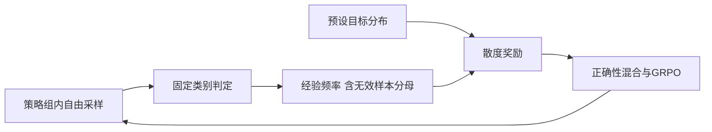
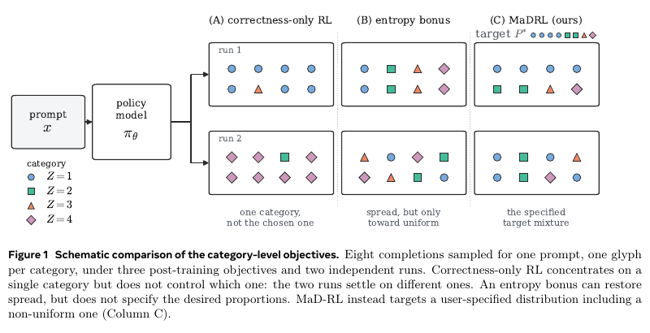

# MaD-RL：类别分布匹配奖励与既有机制诊断

> Google/Meta优先资料与实验关联。**完整实验成本过高，不复现（审查 DONE）**；既有机制诊断保留，不能升级为原文数学/代码能力复现。

## 论文信息

| 字段 | 内容 |
| --- | --- |
| 论文链接 | [arXiv 2609.31644](https://arxiv.org/abs/2609.31644)；[Meta官方页](https://ai.meta.com/research/publications/mad-rl-matching-distributions-for-calibrating-llms-with-reinforcement-learning/) |
| 公司 / 机构 | 一作Sourabh Kulkarni，Meta Superintelligence Labs |
| 首次公开日期 | 2026-09-12 11:12:59 UTC，arXiv v1；Meta目录09-24，不使用PDF落款替代首发 |
| 原作者代码 | 在已核原文与官方源码检索中未找到作者实现；不混用同名机器人控制MAD仓库 |
| 本地 adapter / 稳定键 | 无正式论文adapter（`adapter: null`）；资料键与既有CLI键`mad-rl`；既有GPU诊断另键`mad-rl-qwen-choice` |
| 本地复现代码 | 既有`src/auto_research/post_training/mad_rl.py`与`scripts/mad_rl_qwen_choice.py`；本次未新增或升级代码 |

## 原始论文总结

### 背景与主要改动

逐条最大化正确性奖励可能令输出类别坍缩；MaD-RL为输出的类别频率拟合指定分布，而非仅提高token熵。它将组内频率与目标类别分布构造的L2、forward-KL、reverse-KL或JSD奖励，与任务正确性结合后用于GRPO。完整分布约束与正确性须分别测量。[原文§2](https://arxiv.org/html/2609.31644v1#S2)

<!-- paper-figure:start -->
### 原论文关键图

> **原文Figure1**：正确性奖励、熵奖励和目标类别分布匹配的区别，来自PDF第2页。图片来自[原论文](https://arxiv.org/abs/2609.31644)，版权归原作者所有；不是本地实验图。
<!-- paper-figure:end -->

### 核心公式

对经验类别频率`p`、目标`q`，L2奖励为`q_z-p_z`，forward-KL为`q_z/p_z-1`，reverse-KL为`log(q_z)-log(p_z)`，JSD为`0.5*(log((q_z+p_z)/2)-log(p_z))`。经验频率更新时视为固定；零概率目标须处理平滑，缺失类别不能凭空收到on-policy奖励。组归一化、clip和任务混合不等同原始population梯度。

### 论文离线与线上效果

论文评测合成类别选择、多语言数学和多语言编程，报告目标分布拟合与正确性权衡；没有工业线上A/B。本地没有复现其完整数学/代码benchmark，不能把下述机制实验分数当作作者结果。

## 本地复现与既有证据

[既有实验、三种子结果与负结果](../../experiments/mad-rl-mechanism.md)仍是事实来源。字符GRU与Qwen3-4B五选项诊断不是原文自由数学/代码任务；Qwen三臂验证完全打平，未观察到分布奖励差异。已有[A100回执](../../gpu-validations/mad-rl-qwen-choice-a100-20260929.json)绑定`mad-rl-qwen-choice`，**不改键、不重新绑定到本资料条目**；本轮没有新增CUDA路径或GPU交付。

## 完整实验成本决策

原文§3.2：Qwen3-4B合成实验6000步、group32、48运行；数学/代码实验1200步、group16、多配方和三种子。**成本过高，不复现（审查 DONE）**。不自动重训、不删负结果、不冒称evolve集成；本次只补目录与日期关联。
