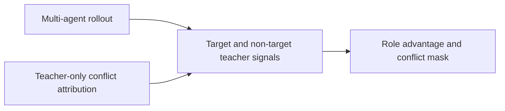
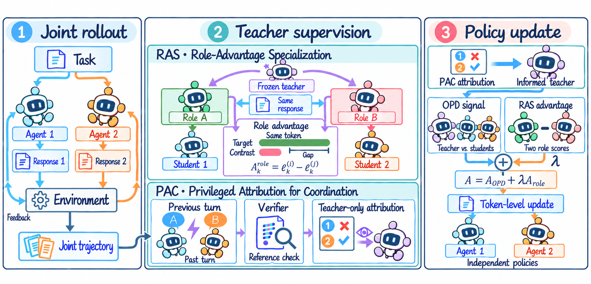

# MAS-OPD: On-Policy Distillation for Multi-Agent Systems

<!-- source-sha256: c6e4151e393dd97af183110d8c108d0d4d2b4b6894ad43dc29773efd5ae8b0e4 -->

[简体中文](README.md)

> L1 role advantage and privileged conflict mask; no joint multi-model MAS training.

## Paper information

| Field | Details |
|---|---|
| Paper | [MAS-OPD: On-Policy Distillation for Multi-Agent Systems](https://arxiv.org/abs/2609.34234) |
| Institution | University of Science and Technology of China (first author). |
| First public release | 2026-09-28 (arXiv v1) |
| Author code | No public author repository found as of 2026-09-30. |
| Local adapter or method key | `mas-opd` |
| Local reproduction code | [`src/auto_research/post_training/latest_20260930_closure.py`](https://github.com/daiwk/auto-research/blob/main/src/auto_research/post_training/latest_20260930_closure.py) |

## Paper method and evidence

Contrast teacher signals for target versus non-target roles to construct role advantage. Give conflict attributions only to the teacher, forming privileged coordination supervision.

<!-- paper-figure:start -->
### Original paper figure

Figure 2 shows the multi-agent distillation framework. From the [original paper](https://arxiv.org/abs/2609.34234); copyright remains with the authors.
<!-- paper-figure:end -->

### Core equation

The reference preserves masking and gradient boundaries; tests include type checks and determinism.

### Reported results

Paper benchmark, speed, and training results are not local capability evidence.

## Local reproduction

[Three-seed mechanism results](metrics/mechanism-seeds42-44.json) are diagnostic_only=true. Fixed-budget fixtures verify the defining operator and auditable intermediate states; they are not a benchmark, production result, or capability-ranking entry.
