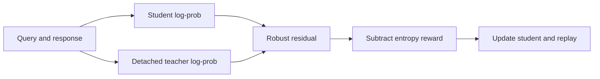
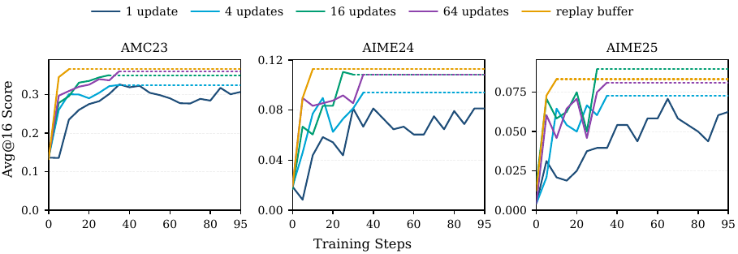

# LSPD: Least-square policy distillation from an RL perspective

<!-- source-sha256: 7d1362bb5720c656da5e81b64687e96453425cf958290ce21492149d8232c297 -->

[简体中文](README.md)

> L1 mechanism and real checkpoint CUDA path; no full reasoning training gains.

## Paper information

| Field | Details |
|---|---|
| Paper | [An RL View of OPD: Least Square Policy Distillation for Sample-Efficient LLM Reasoning](https://arxiv.org/abs/2609.35505) |
| Institution | University of North Carolina at Chapel Hill (first author). |
| First public release | 2026-09-28 (arXiv v1) |
| Author code | [UNCSciML/LSPD](https://github.com/UNCSciML/LSPD). |
| Local adapter or method key | `lspd` |
| Local reproduction code | [`src/auto_research/post_training/latest_20260930.py`](https://github.com/daiwk/auto-research/blob/main/src/auto_research/post_training/latest_20260930.py) |

## Paper method and evidence

Use teacher–student log-probability residuals, squared near zero and linear in the tails, with reuse of historical query–response trajectories.

<!-- paper-figure:start -->
### Original paper figure

The original method figure shows the RL interpretation and replay flow. From the [original paper](https://arxiv.org/abs/2609.35505); copyright remains with the authors.
<!-- paper-figure:end -->

### Core equation

For $d_t=\log\pi_\theta(y_t)-\operatorname{sg}(\log\pi_T(y_t))$, use $d_t^2$ if $|d_t|\le c$, else $2c|d_t|-c^2$, then subtract entropy regularization. Average valid tokens per response, then responses equally.

### Reported results

Reasoning benchmark and sample-efficiency claims belong to the paper. [Local three-seed metrics](metrics/mechanism-seeds42-44.json) only test teacher stop-gradient, tails, masks and replay. [A100 receipt](../../gpu-validations/lspd-a100-20260930.json).

## Local reproduction

`lspd_objective` and `LSPDReplayBuffer` support direct training use; the generic post-training CLI is an L1 candidate-policy analog. [Aggregated metrics](../../experiments/sep30-p0-p1-mechanisms-seeds42-44.json). No full reasoning data pipeline, large teacher rollout or Evolve integration; real controller updates plus isolated validation are required.
