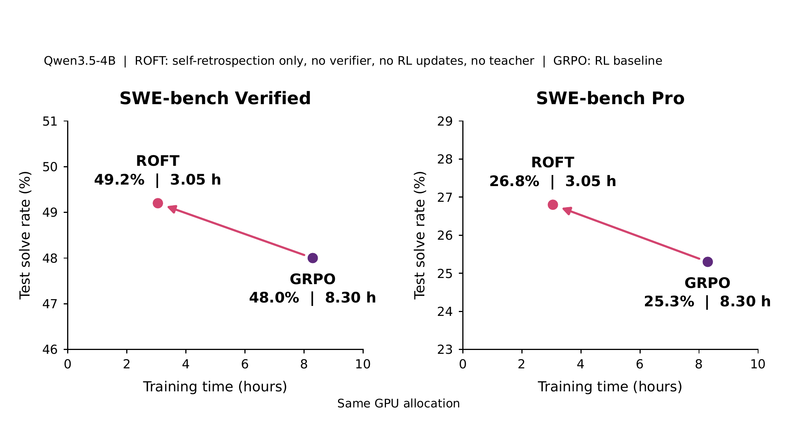

# ROFT: improving agents through supervised self-retrospection

<!-- source-sha256: 0bbf172692d2569f45906af648789f73aa44675f3b3dac30060c8ad7845abb3a -->

[简体中文](README.md)

> **L1 core mechanism and real-checkpoint CUDA path.** Implements global retrospection-token cross-entropy; does not establish paper-scale training gains.

## Paper information

| Field | Details |
|---|---|
| Paper | [Shockingly Simple Self-retrospection Improves Agentic Models Without RL](https://arxiv.org/abs/2609.35741) |
| Organization | First-author affiliation: Rensselaer Polytechnic Institute |
| First public release | 2026-09-28 (arXiv v1) |
| Authors' code | No author-released implementation was found as of 2026-09-30. |
| Adapter / method | `roft` |
| Local reproduction code | [`src/auto_research/post_training/latest_20260930.py`](https://github.com/daiwk/auto-research/blob/main/src/auto_research/post_training/latest_20260930.py) |

## Original paper

### Motivation and method

Instead of directly updating the action policy with environment rewards, ROFT generates a self-retrospection after the complete trajectory and feedback, then supervises retrospection tokens only. The resulting training signal can inform future behavior without treating environment text or prior actions as targets.

~~~mermaid
flowchart LR
  T[Task and interaction trajectory] --> F[Environment feedback]
  F --> R[Model generates retrospection]
  R --> M[Target mask retains retrospection tokens only]
  M --> L[Global token-mean cross-entropy]
~~~

<!-- paper-figure:start -->
### Key figure from the paper

> **Paper overview:** Trajectory, feedback, self-retrospection, and next-round behavior. From the [original paper](https://arxiv.org/abs/2609.35741); copyright remains with the authors.
<!-- paper-figure:end -->

### Core equation

Let $R$ be the retrospection tokens. The implementation follows the paper's globally normalized objective $\mathcal L=-\frac{1}{|R|}\sum_{t\in R}\log p_\theta(r_t\mid x,\tau,f,r_{<t})$. Tasks, actions, observations, and feedback have zero target mask but remain available as context.

### Paper results

The paper reports gains from self-retrospection supervision on several agent tasks. These are not local results. The local [three-seed diagnostic](metrics/mechanism-seeds42-44.json) checks masks, gradients, and real-checkpoint CUDA forward and backward execution.

See the [sanitized real NVIDIA A100 receipt](../../gpu-validations/roft-a100-20260930.json).

## Local reproduction

`roft_retrospection_loss` is a trainable PyTorch objective. The general post-training CLI's `roft` supplies only a small candidate-policy diagnostic. See the [combined experiment artifact](../../experiments/sep30-p0-p1-mechanisms-seeds42-44.json).

## Reproduction boundaries

There is no paper-scale agent rollout dataset and ROFT is not registered in evolve. A registry label would not establish integration: the controller would need to construct retrospection data, train, and evaluate on isolated validation data.
