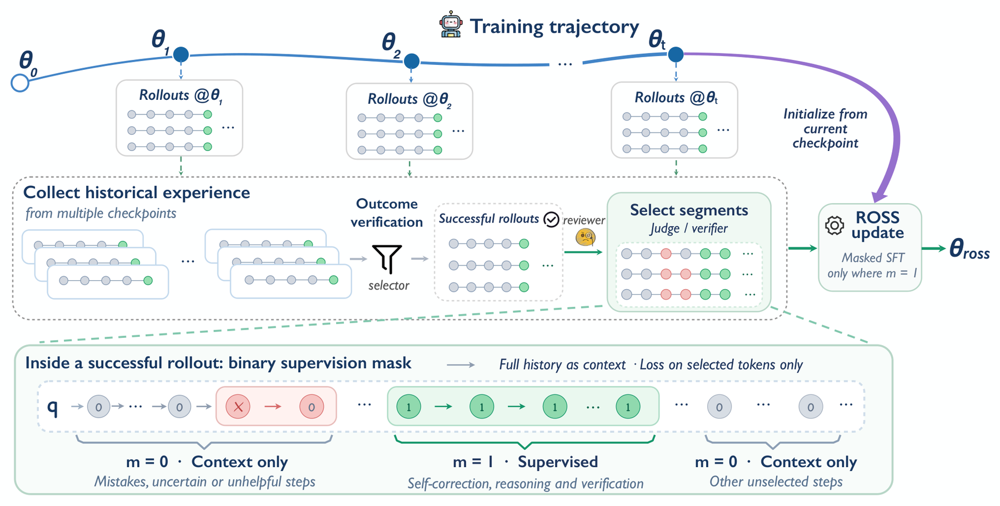

# ROSS: Relearning from Self-Generated Rollouts through Selective Supervision

<!-- source-sha256: 18cd943e7790ebfdc27c06f874cd7fb3b267b2edb1d16af2a60ddef07480c796 -->

[简体中文](README.md)

> **L1 core-mechanism diagnostic.** Checks the full-context/selective-loss boundary. A fixture mask is not the paper's selector.

## Paper information

| Field | Details |
|---|---|
| Paper | [ROSS: Relearning from Self-Generated Rollouts through Selective Supervision](https://arxiv.org/abs/2609.35954) |
| Organization | AllSpark Team; the paper lists the team byline without a separate institutional affiliation. |
| First public release | 2026-09-28 (arXiv v1) |
| Authors' code | No public author repository was found as of 2026-09-30. |
| Adapter / method | `ross` |
| Local reproduction code | [`src/auto_research/post_training/latest_20260930_closure.py`](https://github.com/daiwk/auto-research/blob/main/src/auto_research/post_training/latest_20260930_closure.py) |

## Original paper

### Motivation and method

Keep the full context of historical self-rollouts but compute loss only on selected model continuations, avoiding imitation of erroneous or redundant steps.

~~~mermaid
flowchart LR
  I[Public input and current state] --> M[ross mechanism]
  M --> A[Auditable intermediates]
  A --> O[Output or state update]
~~~

<!-- paper-figure:start -->
### Key figure from the paper

> **Figure 4:** Overview of the paper's method and its key components. From the [original paper](https://arxiv.org/abs/2609.35954); copyright remains with the authors. Click the image for the source.
<!-- paper-figure:end -->

### Core computation

The reference kernel retains the paper's decisive gates, masks, recursion, credit weights, or promotion conditions. Tests also check gradient isolation, type boundaries, and determinism.

### Paper results

Benchmarks, speed, and training curves belong to the paper. The local three-seed mini-suite checks mechanisms and invariants, not paper-scale results or online gains.

## Local reproduction

See the [three-seed diagnostic](metrics/mechanism-seeds42-44.json), marked `diagnostic_only=true` and ineligible for formal capability ranking.

## Reproduction boundaries

The local run covers the full-context/selective-loss boundary only. Its selection mask is a fixture, not a reproduction of the paper's selector.
