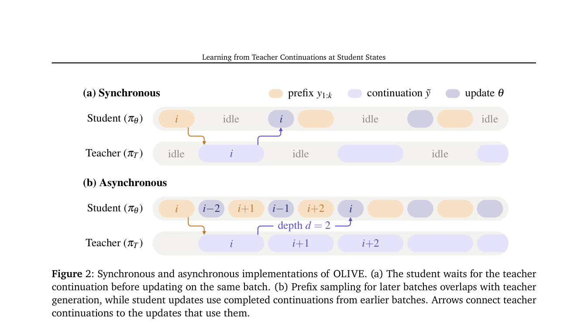

# OLIVE: Learning from Teacher Continuations at Student States

<!-- source-sha256: 5cc802b0d3ebc5c2b40e3868d84aef736f1b86e03e337a6c022efa67a0b1f33c -->

[简体中文](README.md)

> L1 exact student-prefix/teacher-continuation loss masking, without a closed teacher call.

## Paper information

| Field | Details |
|---|---|
| Paper | [Learning from Teacher Continuations at Student States](https://arxiv.org/abs/2609.36246) |
| Institution | University of Illinois Urbana-Champaign (first author). |
| First public release | 2026-09-28 (arXiv v1) |
| Author code | The source lists the [author project](https://dylanzsz.github.io/olive/) as the release link. |
| Local adapter or method key | `olive` |
| Local reproduction code | [`src/auto_research/post_training/latest_20260930_closure.py`](https://github.com/daiwk/auto-research/blob/main/src/auto_research/post_training/latest_20260930_closure.py) |

## Paper method and evidence

Have the current student generate a prefix, then ask the teacher to continue from that student state. Train on teacher continuation tokens only.

<!-- paper-figure:start -->
### Original paper figure

Figure 2 shows learning from teacher continuations on student states. From the [original paper](https://arxiv.org/abs/2609.36246); copyright remains with the authors.
<!-- paper-figure:end -->

### Core equation

Cross-entropy is masked off the student prefix. Tests check gradient isolation, type boundaries and deterministic execution.

### Reported results

The paper's benchmark, speed, and learning-curve outcomes are not local capability evidence.

## Local reproduction

[Three-seed mechanism results](metrics/mechanism-seeds42-44.json) are diagnostic_only=true. Fixed-budget fixtures verify the defining operator and auditable intermediate states; they are not a benchmark, production result, or capability-ranking entry.
