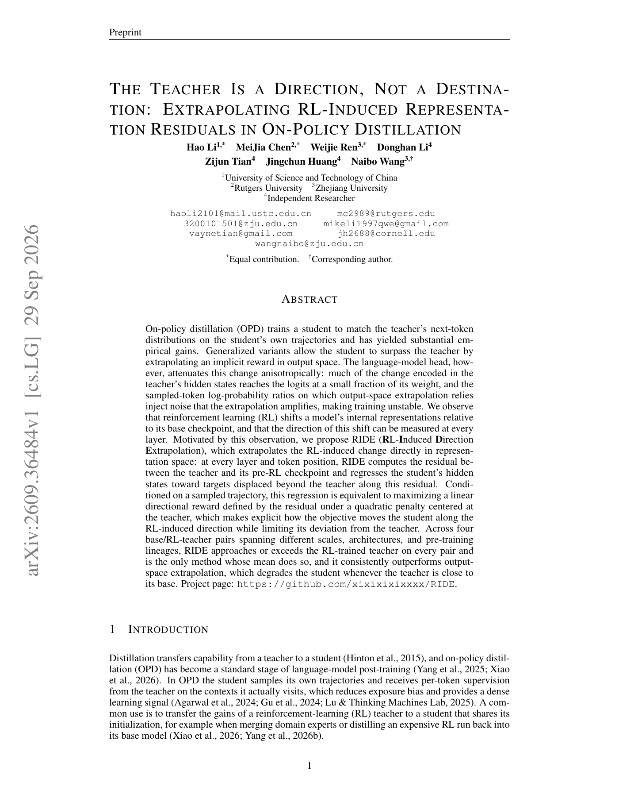

# RIDE: Extrapolate along the RL teacher's representation residual

<!-- source-sha256: 994a07c5f022501f1a58b2779e640ad9dfcf82bdafd7290856ce319c150510ca -->

[简体中文](README.md)

> L1 representation target: layerwise base-to-RL extrapolation and masked regression.

## Paper information

| Field | Details |
|---|---|
| Paper | [arXiv v1](https://arxiv.org/abs/2609.36484) |
| Institution | No affiliation listed in the paper. |
| First public release | 2026-09-29 (arXiv v1) |
| Author code | [xixixixixxxx/RIDE](https://github.com/xixixixixxxx/RIDE). |
| Local adapter or method key | `ride-opd` |
| Local reproduction code | `src/auto_research/post_training/latest_20260930_followup.py` |

## Paper method and evidence

Instead of amplifying the teacher–student output probability ratio, take the hidden-state residual from each token/layer of the RL teacher relative to its pre-RL checkpoint. The student regresses to a point beyond the teacher; detach teacher and base so the target branch cannot be updated.

<!-- paper-figure:start -->
### Original paper figure

The first-page overview contrasts output-space and representation-space extrapolation. From the [original paper](https://arxiv.org/abs/2609.36484); copyright remains with the authors.
<!-- paper-figure:end -->

### Core equation

$r=h_T-h_B$ and target $h_B+\alpha r$; $\alpha>1$ extends beyond the teacher.

## Local reproduction

`ride_target` and `ride_loss` test the $α=1$ special case, $α>1$ extrapolation, the token mask, and teacher stop-gradient. See the [three-seed mechanism results](metrics/mechanism-seeds42-44.json). No four real base/RL checkpoint pairs were loaded, so this does not reproduce the paper's outcomes.
