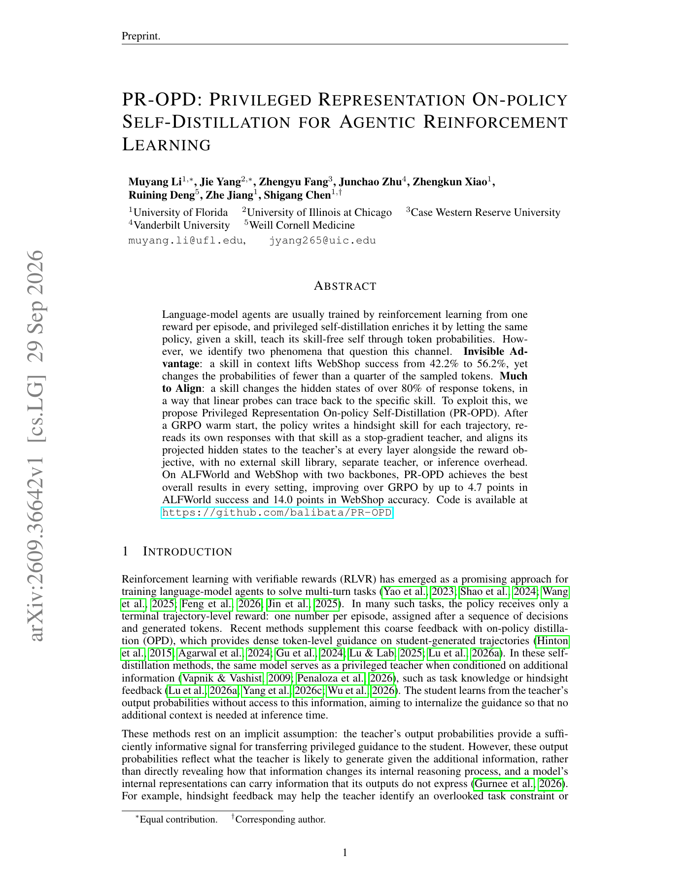

<!-- source-sha256: b61a3813b49b7a2fc97c5f4b6bf37c1c8987b3c51a613cd988d304f83edb4569 -->

[简体中文](README.md) · English

# PR-OPD: Privileged representation self-distillation for agentic RL

> **L1 representation-alignment objective.** Implements stop-gradient privileged alignment across layers and response tokens.

## Paper information

| Field | Details |
|---|---|
| Paper | [arXiv v1](https://arxiv.org/abs/2609.36642) |
| Institution | University of Florida (first author affiliation) |
| First public release | 2026-09-29 (arXiv v1) |
| Original source code | Yes: [balibata/PR-OPD](https://github.com/balibata/PR-OPD) |
| Adapter | `pr-opd` |
| Local reproduction code | `src/auto_research/post_training/latest_20260930_followup.py` |

### Background and main changes

After a GRPO warm start, the policy writes a hindsight skill for each completed trajectory. Run two forward passes on the same response with ordinary context and skill context. The latter is a stop-gradient teacher. PR-OPD aligns projected hidden states at each layer and response token, then combines alignment with the reward objective. Inference removes the skill and teacher branch.

<!-- paper-figure:start -->
### Key figure from the paper

> Figure 1 motivates representation alignment by contrasting sparse probability signals with widespread hidden-state changes. From the [paper](https://arxiv.org/abs/2609.36642); copyright belongs to the authors.
<!-- paper-figure:end -->

## Local reproduction

Tests cover zero loss for identical representations, positive loss for different ones, masking and teacher stop-gradient. See [three-seed mechanism results](metrics/mechanism-seeds42-44.json). ALFWorld, WebShop and the GRPO warm start were not run. The paper's maximum `+14.0` points cannot be claimed here.
