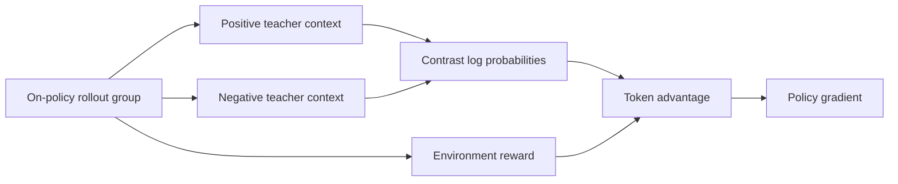
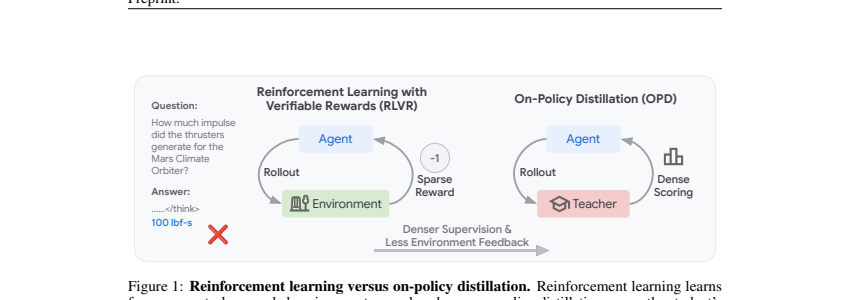

# SIPO: Unifying RLVR and on-policy self-distillation

<!-- source-sha256: f44174198e2515193234816b3f599c8fcec35168dd4e51273e150f90f2eb3891 -->

[简体中文](README.md)

> L1 dual-context objective and policy gradient; no paper-scale rollouts.

## Paper information

| Field | Details |
|---|---|
| Paper | [SIPO](https://arxiv.org/abs/2609.36742) |
| Institution | University of Illinois Urbana-Champaign (first author). |
| First public release | 2026-09-29 (arXiv v1) |
| Author code | [Yueeeeeeee/SIPO](https://github.com/Yueeeeeeee/SIPO). |
| Local adapter or method key | `sipo` |
| Local reproduction code | [`src/auto_research/post_training/latest_20260930.py`](https://github.com/daiwk/auto-research/blob/main/src/auto_research/post_training/latest_20260930.py) |

## Paper method and evidence

Sparse outcome reward gives little token-level credit, while ordinary OPSD can overtrust its teacher or penalize long sequences. Construct positive and negative privileged teacher contexts for the same on-policy rollout. Their log-probability difference cancels shared bias. Environment reward sets the main direction; dense evidence redistributes credit across tokens.

<!-- paper-figure:start -->
### Original paper figure

Figure 1 contrasts sparse RLVR and dense OPD supervision. From the [original paper](https://arxiv.org/abs/2609.36742); copyright remains with the authors.
<!-- paper-figure:end -->

### Core equation

$e_t=\log q_t^+-\log q_t^-$ and $A_t=A_{outcome}+\beta(e_t-\bar e)$. Even tied outcome rewards can have nonzero token signal without gold in student rollout.

### Reported results

The authors report gains over RLVR and OPSD on reasoning and coding. Not local evidence.

## Local reproduction

[Three-seed results](metrics/mechanism-seeds42-44.json) test all-failure groups with token signal, finite gradients, and retention of the outcome direction. [Sanitized A100 receipt](../../gpu-validations/sipo-a100-20260930.json).
