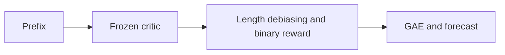
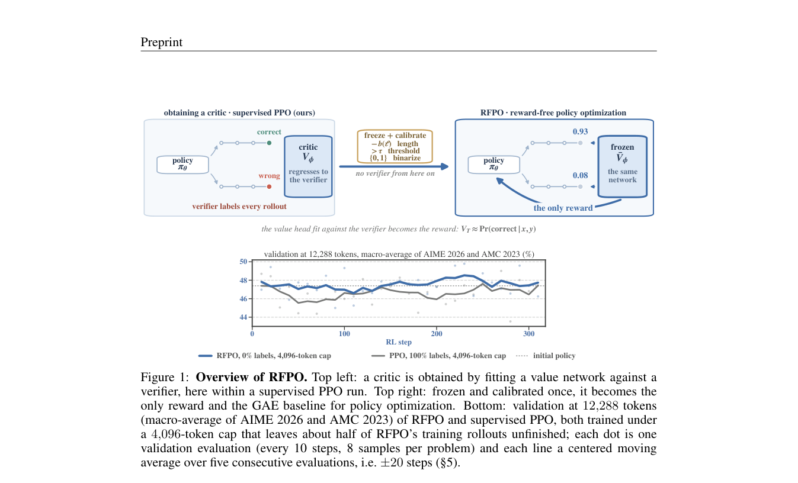

# Unlocking the Critic: Reward-Free Policy Optimization for LLM Post-Training

<!-- source-sha256: e0357b2a0c76ce7e948bba3ceb8c4e30853febd5d1ffb615b8eac2e17c9035aa -->

[简体中文](README.md)

> **L1 mechanism diagnostic.** Frozen-critic debiasing, binary rewards, and GAE; no long-chain model training.

## Paper information

| Field | Value |
| --- | --- |
| Paper | [Unlocking the Critic: Reward-Free Policy Optimization for LLM Post-Training](https://arxiv.org/abs/2609.37119) |
| Affiliations | University of Luxembourg, first author's affiliation |
| First public release | 2026-09-29 (arXiv v1) |
| Authors' code | No public author repository found as of 2026-09-30. |
| Adapter / method | `rfpo` |
| Local code | [`src/auto_research/post_training/latest_20260930_closure.py`](https://github.com/daiwk/auto-research/blob/main/src/auto_research/post_training/latest_20260930_closure.py) |

## Original paper

### Background and contribution

Freeze a calibrated critic and reuse prefix success probability as rollout reward, GAE baseline, and unfinished-trajectory forecast. Remove length bias before binarization to limit exploitation of critic bias.

<!-- paper-figure:start -->
### Key figure from the paper

Original Figure 1: critic-based training. From the [paper](https://arxiv.org/abs/2609.37119); copyright belongs to the authors. Not a local result.
<!-- paper-figure:end -->

### Core mechanism

The reference preserves gates, masks, recursion, credit, and acceptance behavior. Tests check gradient isolation, type boundaries, and determinism.

### Paper results

Benchmarks, speed, and learning curves belong to the paper, not the three-seed mini-suite or online impact.

## Local reproduction

[Three-seed diagnostics](metrics/mechanism-seeds42-44.json) are `diagnostic_only=true`, excluded from capability rankings.

## Reproduction limits

The critic mechanism runs but does not train a long-chain reasoning model.
