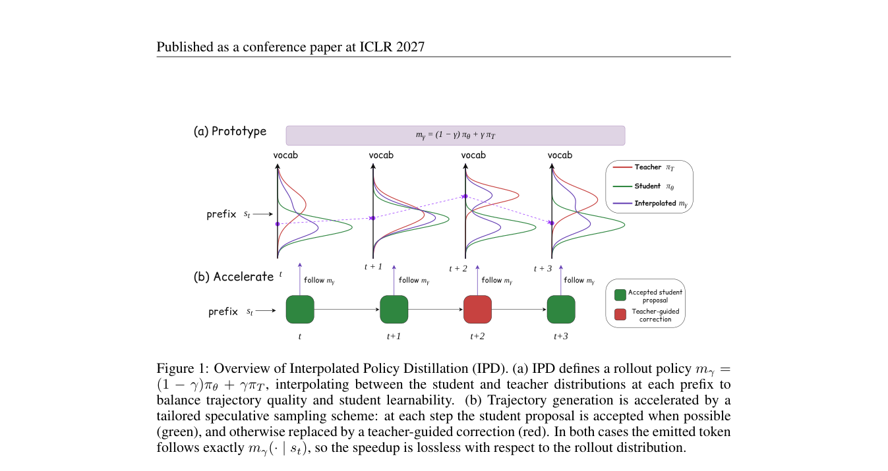

<!-- source-sha256: e497e39af7a96d3e339325b4b85797e4337e0749202154d1ad815dfe23d7af6e -->

[简体中文](README.md) · English

# Interpolated Policy Distillation: A Controllable Continuum Between Off-Policy and On-Policy Distillation

> **L1 core mechanism diagnostic.** Exact token mixtures run; the high-throughput speculative sampler and model training are not reproduced.

## Paper information

| Field | Details |
|---|---|
| Paper | [arXiv 2609.37170](https://arxiv.org/abs/2609.37170) |
| Institution | WeChat Vision, Tencent (first author affiliation) |
| First public release | 2026-09-29 (arXiv v1) |
| Original source code | No public author repository found as of 2026-10-01. |
| Adapter | `ipd` |
| Local reproduction code | [`src/auto_research/post_training/latest_20261001.py`](https://github.com/daiwk/auto-research/blob/main/src/auto_research/post_training/latest_20261001.py) |

## Original paper summary

### Background and main changes

Interpolate student and teacher at every token state as $m_\gamma=(1-\gamma)\pi_S+\gamma\pi_T$, giving a continuum from pure on-policy student to off-policy teacher. The paper samples this target policy exactly using a verification-aware speculative sampler.

<!-- paper-figure:start -->
### Key figure from the paper

> **Figure 1:** Overall design and components. From the [paper](https://arxiv.org/abs/2609.37170); copyright belongs to the authors. Click for the source.
<!-- paper-figure:end -->

### Core equations

$m_\gamma(\cdot|s)=(1-\gamma)\pi_S(\cdot|s)+\gamma\pi_T(\cdot|s)$. Local checks cover endpoints, normalization and linear interpolation in total variation.

### Offline and online results

The paper compares SFT, OPD, SFT→OPD and several interpolation coefficients on text and multimodal tasks. Paper-scale gains are not local results.

## Local reproduction

> **Comparison protocol:** Disabled or default mechanism versus enabled operator. Only invariants and state transitions are checked; cross-model relative change is not applicable.

See [`metrics/mechanism-seeds42-44.json`](metrics/mechanism-seeds42-44.json). `diagnostic_only=true` means executable state transitions, gradients or scheduling invariants, not formal capability ranking.

## Scope

The exact token mixture runs; high-throughput speculative sampling and model training are not reproduced.
