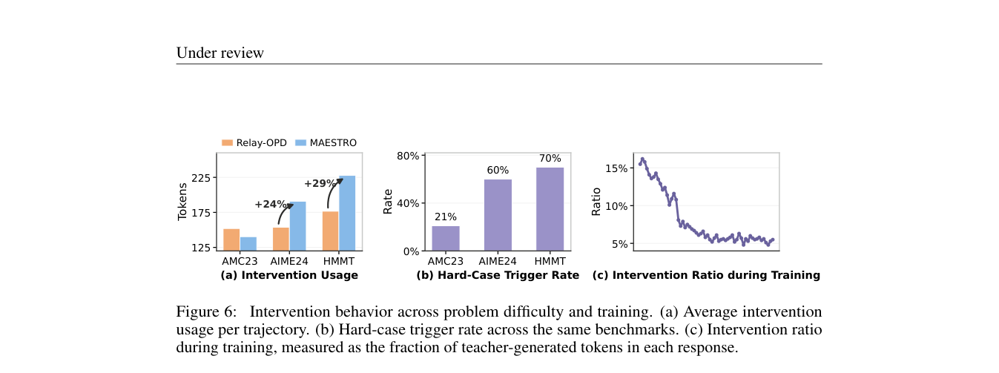

# From Dissonance to Orchestration: Teacher Intervention in On-Policy Distillation

<!-- source-sha256: 0469e2673d0bc55379a0c801a9b3ea12ddc43faddb75f5c1a4ed4d5b0947a940 -->

[简体中文](README.md)

> **L1 mechanism diagnostic.** Top-k coverage/Bhattacharyya PDS, no teacher rollout generation.

## Paper information

| Field | Value |
| --- | --- |
| Paper | [arXiv 2609.37510](https://arxiv.org/abs/2609.37510) |
| Affiliations | Nanyang Technological University, first author's affiliation |
| First public release | 2026-09-29 (arXiv v1) |
| Authors' code | [MAESTRO](https://github.com/yhao-wang/MAESTRO) |
| Adapter / method | `maestro-opd` |
| Local code | [`src/auto_research/post_training/latest_20261001.py`](https://github.com/daiwk/auto-research/blob/main/src/auto_research/post_training/latest_20261001.py) |

## Original paper

### Background and contribution

Compute per-token disagreement with teacher top-k coverage and Bhattacharyya similarity, emphasizing positions near the response start. Intervene where disagreement is high rather than paying for full teacher rollouts.

<!-- paper-figure:start -->
### Key figure from the paper

Original Figure 6: training and teacher intervention. From the [paper](https://arxiv.org/abs/2609.37510); copyright belongs to the authors. Not a local result.
<!-- paper-figure:end -->

### Core mechanism

$PDS_t=1-C_tB_t$; $C_t$ is the teacher probability covered by the student's top-k and $B_t$ the Bhattacharyya coefficient of normalized top-k distributions.

### Paper results

Qwen3 0.6B/1.7B report the best macro averages across eight math benchmarks and about 67.3% shorter responses than standard OPD.

## Local reproduction

Compare disabled/default and enabled. [Three-seed diagnostics](metrics/mechanism-seeds42-44.json) verify only mechanism invariants and transitions (`diagnostic_only=true`).

## Reproduction limits

PDS calculation only, not teacher rollout generation or full benchmark training.
