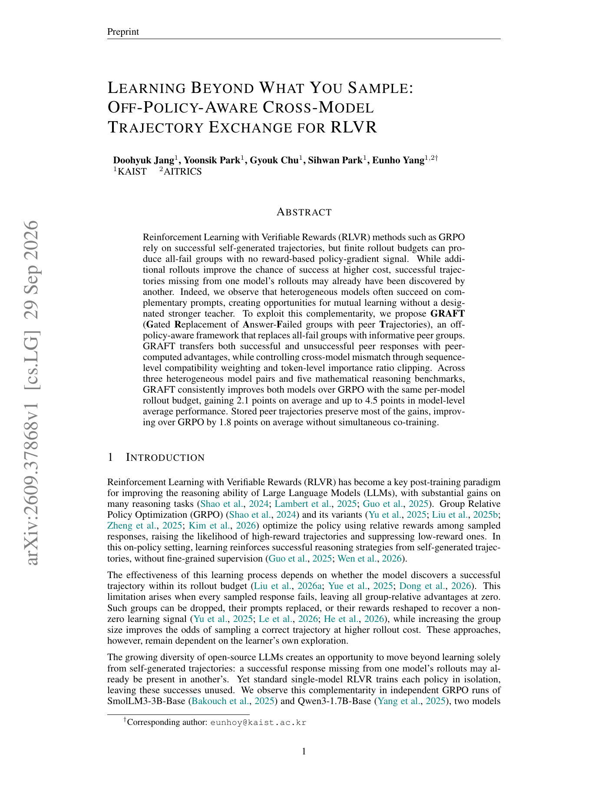

# GRAFT: Exchange all-fail rollout groups across models

<!-- source-sha256: 7a6da683a81dc37dc8be23b225e8b99c47794b54fe9fb402e70707c051107fc9 -->

[简体中文](README.md)

> L1 objective mechanism: peer compatibility gating, source-advantage preservation, and token ratio clipping.

## Paper information

| Field | Details |
|---|---|
| Paper | [arXiv v1](https://arxiv.org/abs/2609.37868) |
| Institution | KAIST (first author). |
| First public release | 2026-09-29 (arXiv v1) |
| Author code | No author repository found as of 2026-09-30. |
| Local adapter or method key | `graft` |
| Local reproduction code | `src/auto_research/post_training/latest_20260930_followup.py` |

## Paper method and evidence

When the receiver's group is entirely wrong and a peer has both successful and failed trajectories on the same prompt, replace the uninformative group with the complete peer group and retain its internal advantages. Sequence-mean log-likelihood compatibility downweights cross-tokenizer policy mismatch; token-level importance ratio clipping bounds updates.

<!-- paper-figure:start -->
### Original paper figure

Figure 1 shows heterogeneous models' complementary successes on all-fail prompts. From the [original paper](https://arxiv.org/abs/2609.37868); copyright remains with the authors.
<!-- paper-figure:end -->

## Local reproduction

Tests verify lower weight for incompatible peers, clipping of out-of-range ratios, and no gradient into source advantages. See the [three-seed mechanism results](metrics/mechanism-seeds42-44.json). No two-model GRPO training or five-benchmark math evaluation; the paper's mean `+2.1`-point gain was not reproduced.
