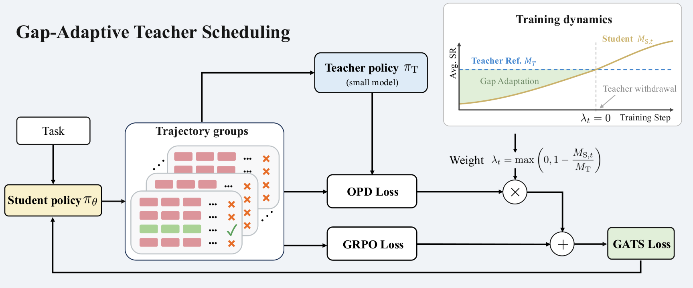

<!-- source-sha256: 6871939f4ac7f5eb752f4829f2bbaf566b34dfe995774637dbc12204a049dd7b -->

[简体中文](README.md) · English

# Guide, Then Let Go: Gap-Adaptive Teacher Scheduling for Sparse-Reward Agentic RL

> **L1 core mechanism diagnostic.** The lagged moving average, gap weight and permanent teacher withdrawal run. No Qwen agent RL was performed.

## Paper information

| Field | Details |
|---|---|
| Paper | [arXiv 2609.37898](https://arxiv.org/abs/2609.37898) |
| Institutions | Dalian University of Technology / Kuaishou (first author affiliations) |
| First public release | 2026-09-29 (arXiv v1) |
| Original source code | Yes: [Ricardo-H/guide-then-let-go](https://github.com/Ricardo-H/guide-then-let-go) |
| Adapter | `gats` |
| Local reproduction code | [`src/auto_research/post_training/latest_20261001.py`](https://github.com/daiwk/auto-research/blob/main/src/auto_research/post_training/latest_20261001.py) |

## Original paper summary

### Background and main changes

Use the teacher's late-training success rate as a fixed reference. A one-step-lagged student moving average estimates the capability gap. OPD weight decreases linearly as the gap closes. Once the student reaches the teacher reference, turn off teacher supervision permanently and continue with GRPO alone.

<!-- paper-figure:start -->
### Key figure from the paper

> **Figure 2:** Training workflow and key optimizations. From the [paper](https://arxiv.org/abs/2609.37898); copyright belongs to the authors. Click for the source.
<!-- paper-figure:end -->

### Core equations

$\lambda_t=\max(1-M_{S,t}/M_T,0)$ and $L_{GATS}=L_{GRPO}+(1-d_t)\lambda_tL_{OPD}$. After $M_{S,t}\ge M_T$, set $d_t$ permanently to one.

### Offline and online results

All three Qwen2.5 teacher/student setups beat matched-budget GRPO, with mean success gains of 4.37–11.87 percentage points in the paper.

## Local reproduction

> **Comparison protocol:** Disabled or default mechanism versus enabled operator. Only invariants and state transitions are checked; cross-model relative change is not applicable.

See [`metrics/mechanism-seeds42-44.json`](metrics/mechanism-seeds42-44.json). `diagnostic_only=true` means executable state transitions, gradients or scheduling invariants, not formal capability ranking.

## Scope

The lagged moving average, gap weighting and permanent withdrawal run. No Qwen agent RL was performed.
