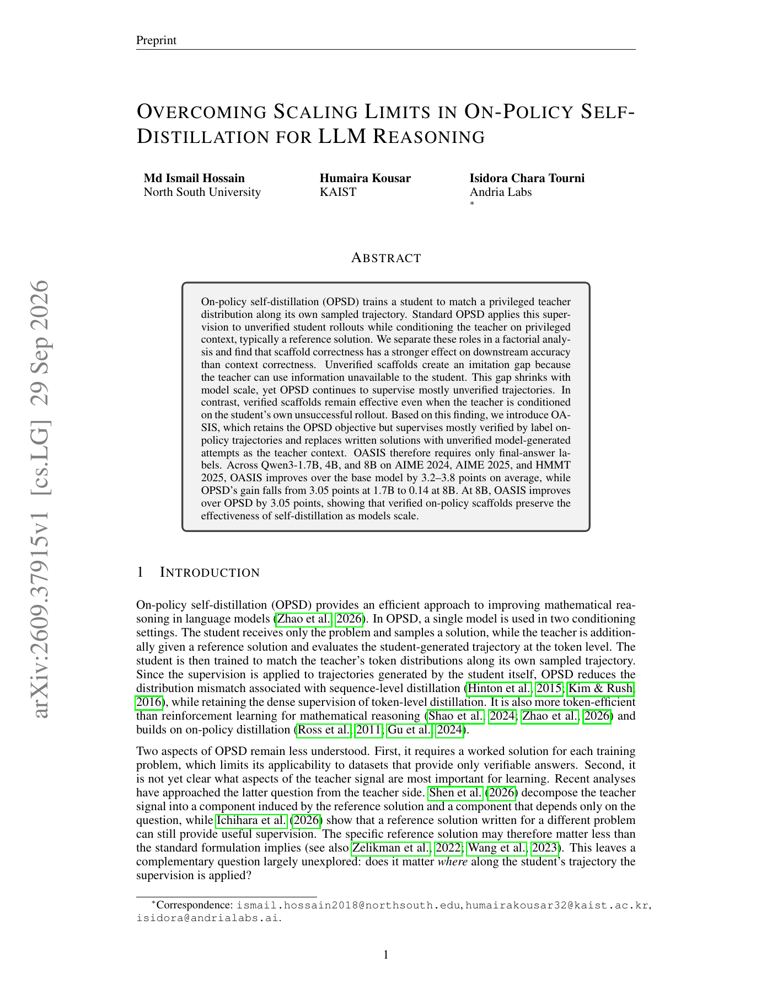

# OASIS: on-policy self-distillation on verified scaffolds

<!-- source-sha256: 94cf3d7c7016b85d434e0b37d5cfe586e7e2f371823eff19b2edd2e0113b81d0 -->

[简体中文](README.md)

> **L1 selection and loss mechanism.** Implements shortest verified scaffold selection, independent same-question teacher context, and clipped forward KL.

## Paper information

| Field | Details |
|---|---|
| Paper | [arXiv v1](https://arxiv.org/abs/2609.37915) |
| Organization | First-author affiliation: North South University |
| First public release | 2026-09-29 (arXiv v1) |
| Authors' code | No author repository was found as of 2026-09-30. |
| Adapter | `oasis-opsd` |
| Local reproduction code | `src/auto_research/post_training/latest_20260930_followup.py` |

### Motivation and method

OASIS separates which trajectory to supervise from which context the teacher sees. For each question, select the shortest verified on-policy rollout as a scaffold and preferentially use a different unverified attempt as teacher context. Questions without a verified rollout produce no training signal. This requires only a final-answer verifier, not a gold solution.

<!-- paper-figure:start -->
### Key figure from the paper

> **Figure 1:** Teacher advantages concentrate on failed trajectories, and OASIS retains gains as scale increases. From the [original paper](https://arxiv.org/abs/2609.37915); copyright remains with the authors.
<!-- paper-figure:end -->

## Local reproduction

Tests check that short unverified trajectories are not chosen, teacher context differs from the scaffold, and masked-out tokens have no gradient. See the [three-seed mechanism results](metrics/mechanism-seeds42-44.json). Qwen3 1.7B–8B rollout and training were not run. This is a mechanism implementation and claims no AIME/HMMT gains.
