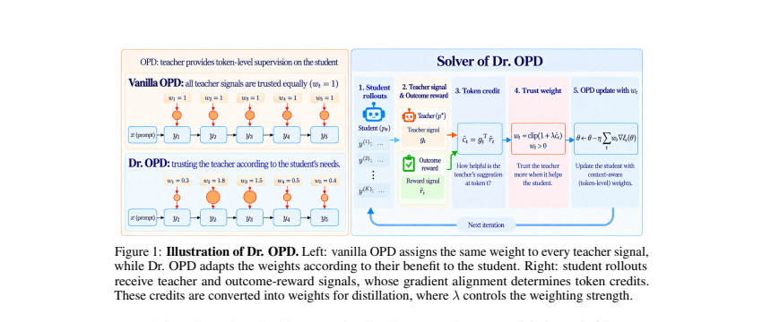

# Dr. OPD: on-policy distillation weighted by downstream reward

<!-- source-sha256: 875f04b150b3fb071062b2238c1c204906f56aee5015159fef1c66c330cc6a23 -->

[简体中文](README.md)

> **L1 objective.** Implements discrepancy × reward-JVP token credit, closed-form weight updates, and weighted reverse KL. No paper-scale bilevel iterative training was run.

## Paper information

| Field | Details |
|---|---|
| Paper | [Dr. OPD](https://arxiv.org/abs/2609.38025) |
| Organization | First-author affiliation: Rutgers University |
| First public release | 2026-09-29 (arXiv v1) |
| Authors' code | [zywang0701/Dr-OPD](https://github.com/zywang0701/Dr-OPD) |
| Adapter / method | `dr-opd` |
| Local reproduction code | [`src/auto_research/post_training/latest_20260930.py`](https://github.com/daiwk/auto-research/blob/main/src/auto_research/post_training/latest_20260930.py) |

## Original paper

### Motivation and method

Vanilla OPD weights all teacher-token signals equally, though correcting a key reasoning error can matter more than changing wording to a synonym. Dr. OPD uses bilevel optimization to choose token weights that maximize expected reward after the student update. Each round first updates weights in closed form, then takes a weighted OPD step.

~~~mermaid
flowchart LR
  S[Student on-policy rollout] --> T[Teacher token distributions]
  S --> R[Downstream reward]
  T --> C[Distribution discrepancy times reward JVP]
  R --> C
  C --> W[Closed-form token weights]
  W --> K[Weighted reverse KL]
  K --> S
~~~

<!-- paper-figure:start -->
### Key figure from the paper

> **Figure 1:** From student rollout and teacher signals to closed-form token weights. From the [original paper](https://arxiv.org/abs/2609.38025); copyright remains with the authors.
<!-- paper-figure:end -->

### Core equations

Local $c_t=d_t\,g_t$ multiplies teacher–student discrepancy by the reward JVP in the token-update direction. Compute $w_t=\mathrm{clip}(1+c_t/\lambda,0,w_{max})$, normalize by the mean, and train with $\sum_t w_t D_{KL}(p_{student,t}\Vert p_{teacher,t})$.

### Paper results

The paper reports consistent gains over vanilla OPD in strong-to-weak and same-size math/code distillation, averaging 9.7 points in strong-to-weak mathematics. See the separate [local mechanism diagnostic](metrics/mechanism-seeds42-44.json); paper values are not local gains.

## Local reproduction and limits

Local checks confirm bounded weights, finite gradients, and differentiated weights for different token credits. See the [sanitized A100 receipt](../../gpu-validations/dr-opd-a100-20260930.json).
