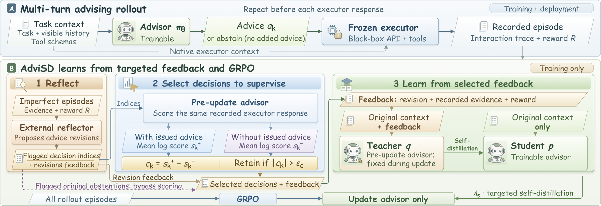

# AdviSD: Learning to Advise Frontier LLMs via Targeted Multi-Turn Self-Distillation

<!-- source-sha256: 0469a47fe4e92035e525d208aa326dcc418bebae3457c65086a7545fc5a91e7c -->

[简体中文](README.md)

> L1 paired contrast, donor calibration, and selection gate; no Gemini/Claude executor or BFCL-v3 run.

## Paper information

| Field | Details |
|---|---|
| Paper | [arXiv 2609.38142](https://arxiv.org/abs/2609.38142) |
| Institution | University of Southern California (first author). |
| First public release | 2026-09-29 (arXiv v1) |
| Author code | No author repository found as of 2026-10-01. |
| Local adapter or method key | `advisd` |
| Local reproduction code | [`src/auto_research/post_training/latest_20261001.py`](https://github.com/daiwk/auto-research/blob/main/src/auto_research/post_training/latest_20261001.py) |

## Paper method and evidence

Freeze the executor and train the advisor. Reflection proposes a correction; score the same logged executor response with and without advice. Distill only decisions with sufficient effect under donor-advice calibration.

<!-- paper-figure:start -->
### Original paper figure

Figure 1 shows the distillation workflow. From the [original paper](https://arxiv.org/abs/2609.38142); copyright remains with the authors.
<!-- paper-figure:end -->

### Core equation

$c_k=T_k^{-1}\sum_t[\log\pi(y_{k,t}|C_k^+)-\log\pi(y_{k,t}|C_k^-)]$. Threshold on an empirical quantile of absolute donor contrasts.

### Reported results

The paper reports 4.2–6.4 percentage points on BFCL-v3 and 3.9–5.1 points on EnvScaler versus advisor-GRPO.

## Local reproduction

Compare with the corresponding operator disabled or in its default state. [Three-seed metrics](metrics/mechanism-seeds42-44.json) are diagnostic_only=true: they verify execution and invariants, not formal gains or capability ranking.
