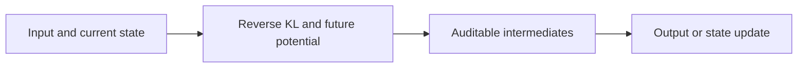
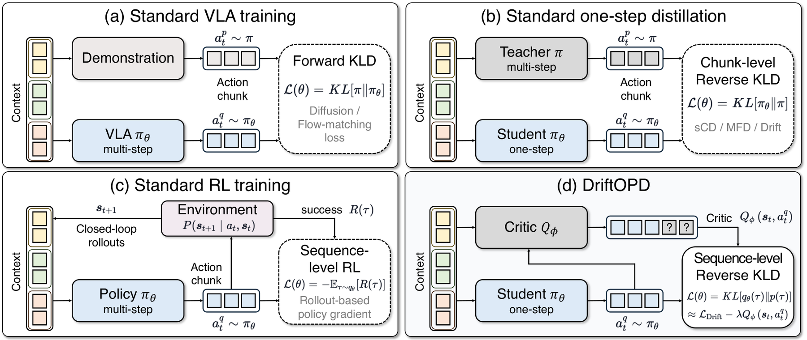

<!-- source-sha256: 37d0b188adb26fdd3f6ce6fac26868acfe3838319e3e9c246b3cbcd718f8393f -->

[简体中文](README.md) · English

# DriftOPD: Sequence-Level Reverse-KL Distillation for One-Step VLA Policies

> **L1 core mechanism diagnostic.** Objective decomposition and teacher stop-gradient run. No robotics environment was used.

## Paper information

| Field | Details |
|---|---|
| Paper | [arXiv v1](https://arxiv.org/abs/2610.00317) |
| Institution | KAIST (first author affiliation) |
| First public release | 2026-09-29 (arXiv v1) |
| Original source code | No public author implementation found as of 2026-10-03. |
| Adapter | `drift-opd` |
| Local reproduction code | [`src/auto_research/post_training/latest_20261003.py`](https://github.com/daiwk/auto-research/tree/main/src/auto_research/post_training/latest_20261003.py) |

## Original paper summary

### Background and main changes

Decompose sequence-level reverse KL into one-step reverse KL for the current action chunk and a future potential for long-horizon consequences. The critic learns from offline demonstrations.

<!-- paper-figure:start -->
### Key figure from the paper

> **Figure 2:** Training workflow and key optimizations. From the [paper](https://arxiv.org/abs/2610.00317); copyright belongs to the authors. Click for the source.
<!-- paper-figure:end -->

### Core equation

$L=KL(\pi_S\|\pi_T)-\lambda E[V_{future}]$.

### Offline and online results

The paper reports improved long-horizon performance for continuous VLA policies without online rollouts.

## Local reproduction

> **Comparison protocol:** Disabled or default mechanism versus its defining operator. L1 does not report formal relative gains; percentages are not applicable.

- Three-seed diagnostic: [`metrics/mechanism-seeds42-44.json`](metrics/mechanism-seeds42-44.json).
- `diagnostic_only=true`; excluded from formal capability rankings.

## Scope

Objective decomposition and teacher stop-gradient run. No robotics environment was used.
