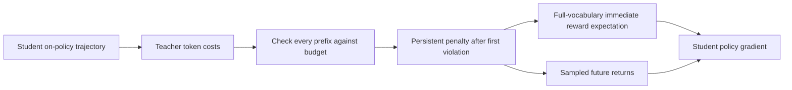
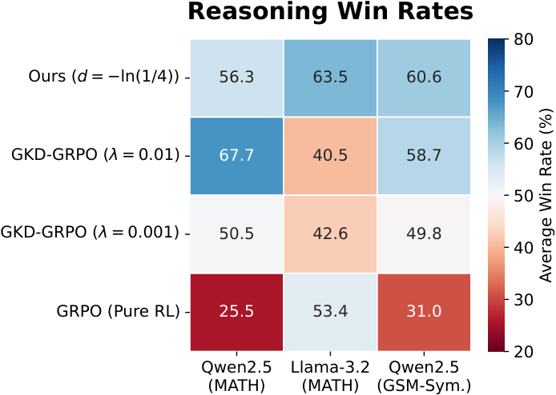

<!-- source-sha256: 1383dcf03a4331f84b839b8dccebe67cf132bed3f71bd38182c22583835a3ae3 -->

[简体中文](README.md) · English

# The Weakest Link: Distillation with a worst-prefix constraint

> **L1 differentiable objective and optimization diagnostic.** Actual full-vocabulary immediate-reward gradients and future Monte Carlo returns are computed. This is not distillation of a complete reasoning model.

## Paper information

| Field | Details |
|---|---|
| Paper | [arXiv 2610.00332](https://arxiv.org/abs/2610.00332) |
| Institution | Huawei Noah's Ark Lab (first author Matthieu Zimmer) |
| First public release | 2026-09-29 (arXiv v1; official first submission date, not the month in its ID) |
| Original source code | No author code found in the 2026-10-04 full-text review. |
| Adapter | `weakest-link` (Python mechanism API) |
| Local reproduction code | [`src/auto_research/post_training/oct04_objectives.py`](https://github.com/daiwk/auto-research/blob/main/src/auto_research/post_training/oct04_objectives.py) |

## Original paper summary

### Background and main changes

Use the teacher's negative log probability of each sampled student token as cost, and constrain average cost at every generated prefix. A violation enters an absorbing penalty state, so easy tokens cannot undo bad reasoning generated earlier. The objective also differentiates the exact full-vocabulary expectation of immediate reward to reduce variance from sampling only the current action.

<!-- paper-figure:start -->
### Key figure from the paper

> **Figure 4:** Overall design and components. From the [paper](https://arxiv.org/abs/2610.00332); copyright belongs to the authors. Click for the source.
<!-- paper-figure:end -->

### Core equations

$c_t=-\log\pi_T(a_t\mid s_t)$, and every $t$ must satisfy $\frac{1}{t}\sum_{i\le t}c_i\le d$. The violation indicator is a cumulative maximum; recovery is not allowed.

$$
L=-\sum_t\gamma^t\left[\sum_a\pi_\theta(a\mid s_t)\hat R(s_t,a)+\gamma G_{t+1}\log\pi_\theta(a_t\mid s_t)\right].
$$

Counterfactual immediate costs use the already incurred cost of the actual visited prefix, then enumerate current actions. They cannot invent a different history per action. Detach teacher scores and rewards; only the student updates.

### Offline and online results

The paper studies constrained reasoning distillation, limiting worst-prefix deviations while balancing teacher guidance with task reward. Figure 4 reports pairwise reasoning-quality win rates of 56.3%, 63.5% and 60.6% for Qwen2.5/MATH, Llama-3.2/MATH and Qwen2.5/GSM-Sym., respectively. These are reasoning win rates, not answer accuracy or local results. The teacher only constrains training and is not called at inference. No production A/B test is reported.

## Local reproduction

`PYTHONPATH=src python scripts/run_oct04_seven_papers.py` trains a three-action student policy with Adam for 80 steps across three random seeds. The fixed public teacher distribution is `[0.7,0.29,0.01]`, budget 2 and penalty 4.

In the [artifact](metrics/mechanism-seeds42-44.json), mean probability of the costly action falls from 0.3546 to 0.01036. This checks the expected gradient, not capability or generalization. Additional tests confirm that the single-step gradient matches enumeration, future penalties affect earlier sampled actions, and later cheap actions cannot cancel a violated prefix.

## Scope

The API takes one unpadded on-policy trajectory with full-vocabulary teacher log-probabilities and task rewards at each visited prefix. The caller supplies actual teacher/student rollouts, variable-length batches, benchmarks and matched-budget controls. Full LLM training is not integrated.
