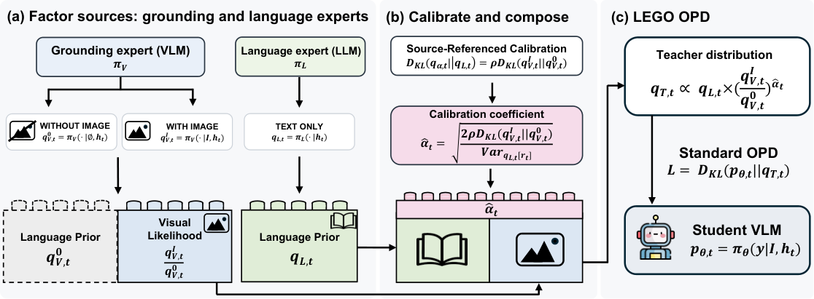

# LEGO-OPD: Factorized Teacher Composition for Multimodal On-Policy Distillation

<!-- source-sha256: 121addddc396d8aa713ac119663a598a98e20091c3843b27f63ab764f3dbc85f -->

[简体中文](README.md)

> **L1 core-mechanism diagnostic.** Executes factorized teacher composition without loading LLM or VLM teachers.

## Paper information

| Field | Details |
|---|---|
| Paper | [LEGO-OPD: Factorized Teacher Composition for Multimodal On-Policy Distillation](https://arxiv.org/abs/2610.00333) |
| Organization | First-author affiliation: KAIST |
| First public release | 2026-09-29 (arXiv v1) |
| Authors' code | No public author implementation was found as of 2026-10-03. |
| Adapter / method | `lego-opd` |
| Local reproduction code | [`src/auto_research/post_training/latest_20261003.py`](https://github.com/daiwk/auto-research/tree/main/src/auto_research/post_training/latest_20261003.py) |

## Original paper

### Motivation and method

Use a language expert as the token prior and a grounding expert only as the visual likelihood. Their product of experts forms the OPD teacher without also distilling the VLM's language bias.

~~~mermaid
flowchart LR
  I[Public input and current state] --> M[lego-opd mechanism]
  M --> A[Auditable intermediates]
  A --> O[Output or state update]
~~~

<!-- paper-figure:start -->
### Key figure from the paper

> **Figure 1:** Overview of the paper's method and its key components. From the [original paper](https://arxiv.org/abs/2610.00333); copyright remains with the authors. Click the image for the source.
<!-- paper-figure:end -->

### Core equation

$p_T(y|x,v)\propto p_L(y|x)p_G(y|x,v)^\alpha$.

### Paper results

The paper reports better grounding on multimodal benchmarks while preserving language reasoning better than using a VLM teacher directly.

## Local reproduction

> **Local comparison:** The baseline disables the mechanism or uses default state; the treatment executes the defining operator. L1 reports no formal relative improvement, and relative percentages are not applicable.

- [Three-seed diagnostic](metrics/mechanism-seeds42-44.json)
- `diagnostic_only=true`, ineligible for formal capability ranking.

## Reproduction boundaries

Factorized teacher composition executes locally. No LLM or VLM teacher was loaded.
