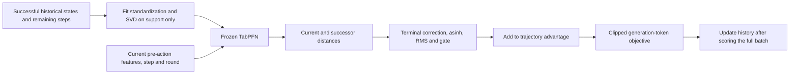
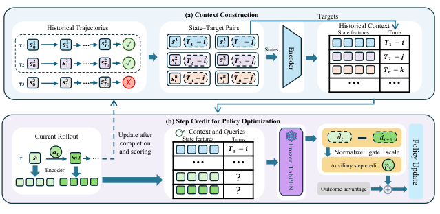

<!-- source-sha256: 3825d2cec7357aac252c6a87a9f620b11b1a87c31a9b1d32af0286fedb40542d -->

[简体中文](README.md) · English

# T2SPO: From trajectory rewards to step-level credit

> **L1 core mechanism diagnostic.** Actual frozen TabPFN distance prediction, historical support sets, step credit and a clipped token objective. No heuristic regressor substitutes for TabPFN. Full LLM and ALFWorld training is not reproduced.

## Paper information

| Field | Details |
|---|---|
| Paper | [arXiv 2610.00388](https://arxiv.org/abs/2610.00388) |
| Institution | Nanjing University (first author Bo-Wen Zhang; the paper also lists an internship collaboration with ByteDance) |
| First public release | 2026-09-30 (arXiv v1) |
| Original source code | No author implementation found in the full-text review on 2026-10-04. TabPFN is a separate dependency, not official T2SPO code. |
| Adapter | `t2spo` (Python mechanism API) |
| Local reproduction code | [`agent_research/t2spo.py`](https://github.com/daiwk/auto-research/blob/main/src/auto_research/agent_research/t2spo.py), [`post_training/oct04_objectives.py`](https://github.com/daiwk/auto-research/blob/main/src/auto_research/post_training/oct04_objectives.py) |

## Original paper summary

### Background and main changes

Use remaining steps from successful historical trajectories to condition a distance estimator in context. It predicts how far each state is from success. Convert distance changes between consecutive states into step advantages and optimize them jointly with trajectory rewards. Frozen TabPFN avoids training another critic; unsuccessful trajectories are not mislabeled as positive near-success examples.



<!-- paper-figure:start -->
### Key figure from the paper

[](https://arxiv.org/html/2610.00388v1/t2spo_overview.png)

> **Figure 1:** Overall design and components. From the [paper](https://arxiv.org/abs/2610.00388); copyright belongs to the authors. Click for the source.
<!-- paper-figure:end -->

### Core equations

Successful-trajectory state labels are $y_t=T-t$. Indexing is zero-based, and the final pre-action state has label 1. $F_t=d_t-\gamma d_{t+1}$, with $d_{t+1}=0$ on successful termination and $F_t=0$ on failed termination. GRPO zeros truncated-step credit. PPO uses actual successor predictions and does not treat truncation as success.

$$
c_t=w g_t\operatorname{clip}\left(\frac{\operatorname{asinh}(F_t)}{\sqrt{\operatorname{mean}_{m_t=1}\operatorname{asinh}(F_t)^2}+\epsilon},-C,C\right).
$$

The caller combines prediction validity, support sufficiency and observation change in the mask. Main GRPO computes $A_t=A^{outcome}_t+c_t$ and uses a masked clipped token surrogate, without gradients on observation or padding tokens. A PPO extension should add credit to rewards before recomputing GAE and use whole-episode likelihood ratios. Here `optimizer="ppo"` **only changes truncation semantics**: it does not implement a PPO critic/GAE trainer.

### Offline and online results

The paper compares step and trajectory credit on multi-turn tasks including ALFWorld/WebShop, separating GRPO and PPO under sparse feedback. No production A/B test is reported. Local synthetic-state estimator and objective diagnostics do not substitute for those results.

## Local reproduction

Formula and gradient checks: `PYTHONPATH=src python scripts/run_oct04_seven_papers.py`.

Run actual TabPFN in a separate environment to avoid Transformers dependency conflicts:

```bash
python -m venv .venv-tabpfn
.venv-tabpfn/bin/pip install 'tabpfn==2.2.1'
# First download tabpfn-v2-regressor.ckpt from Prior-Labs/TabPFN-v2-reg,
# pinned revision: 4972a65a1b30806315c6f92499959ffbfc69a673
TABPFN_DISABLE_TELEMETRY=1 PYTHONPATH=src .venv-tabpfn/bin/python \
  scripts/run_oct04_seven_papers.py --tabpfn-checkpoint /path/to/tabpfn-v2-regressor.ckpt
```

`TrajectoryMemory` rejects nonfinite features, admits only completed successful trajectories, and bounds FIFO capacity. `FrozenDistanceEstimator.fit_snapshot` freezes one history snapshot and fits standardization/SVD only on it. **Score the entire batch before admitting its successes.** Future states in the current trajectory cannot inform its own scores.

[Objective artifacts](metrics/mechanism-seeds42-44.json) check positive and negative progress, termination and gradients. [Actual TabPFN CPU artifacts](metrics/tabpfn-cpu.json) retain checkpoint revision/hash, three-seed MAE, and the check that an old prediction snapshot remains unchanged after history updates.

## Scope

Local pre-action inputs are public synthetic numeric states, not a frozen text encoder. Full ALFWorld/WebShop rollouts, text encoding and LLM weight updates were not done. TabPFN MAE is not task success. No full CUDA training or formal Evolve integration.
