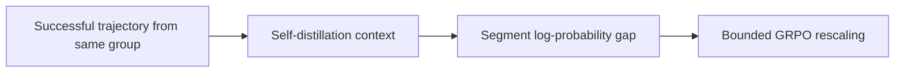
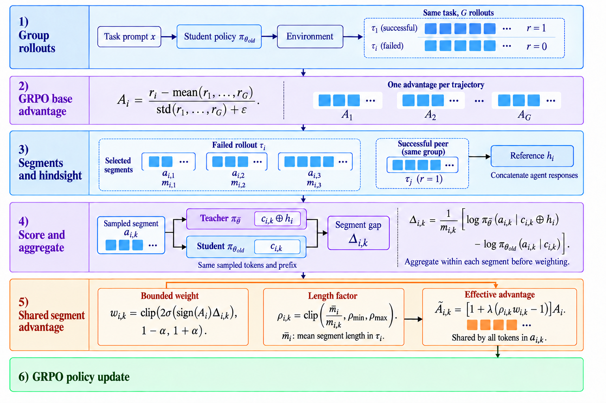

# SHARPO: Segment-Level Credit Assignment for Agentic Reinforcement Learning

<!-- source-sha256: e3b9ba9110f8b6c16385e857050650c037d983f2d964ae5479611f514fef4f91 -->

[简体中文](README.md)

> L1 segment credit; no gold plan access or 7B agent training.

## Paper information

| Field | Details |
|---|---|
| Paper | [arXiv v1](https://arxiv.org/abs/2610.00838) |
| Institution | Georgia Institute of Technology (first author). |
| First public release | 2026-09-30 (arXiv v1) |
| Author code | No public author implementation found as of 2026-10-03. |
| Local adapter or method key | `sharpo` |
| Local reproduction code | [`src/auto_research/post_training/latest_20261003.py`](https://github.com/daiwk/auto-research/tree/main/src/auto_research/post_training/latest_20261003.py) |

## Paper method and evidence

Use a successful trajectory from the same group as self-distillation context. Measure teacher–student log-probability differences within each environment-interaction segment and rescale its GRPO advantage with a bounded multiplier.

<!-- paper-figure:start -->
### Original paper figure

Figure 2 shows segment-level credit assignment. From the [original paper](https://arxiv.org/abs/2610.00838); copyright remains with the authors.
<!-- paper-figure:end -->

### Core equation

$A_{seg}=A\cdot2\sigma(\overline{\log p_T-\log p_S})$.

### Reported results

The authors report that Qwen2.5-7B-Instruct beats GRPO, SDAR, RLSD, and StepOPSD on ALFWorld and WebShop.

## Local reproduction

Compare against the mechanism disabled or in its default state. The [three-seed diagnostic](metrics/mechanism-seeds42-44.json) is `diagnostic_only=true`; no formal relative gain or capability ranking.
