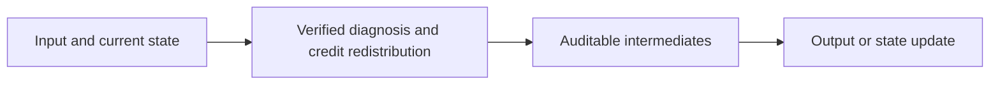
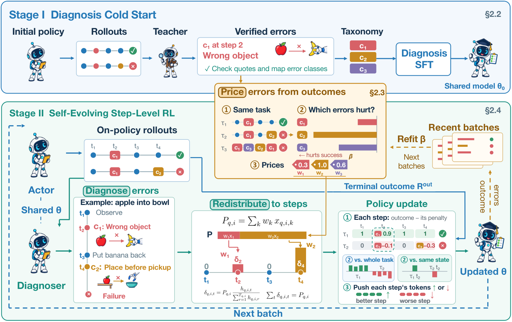

<!-- source-sha256: 2775759bbeb8cf1ef961cb1c684043d402c0ee3741e53154616197d458880810 -->

[简体中文](README.md) · English

# My FAULT: Self-Diagnosis as Credit Assignment in Self-Evolving Agentic Reinforcement Learning

> **L1 core mechanism diagnostic.** Verified diagnosis, error costs and credit-conserving redistribution execute. The policy and diagnostic model were not trained jointly.

## Paper information

| Field | Details |
|---|---|
| Paper | [arXiv 2610.01161](https://arxiv.org/abs/2610.01161) |
| Institution | Alibaba Group (first author affiliation) |
| First public release | 2026-10-01 (arXiv v1) |
| Original source code | No public author implementation found as of 2026-10-02. |
| Adapter | `my-fault` |
| Local reproduction code | [`src/auto_research/post_training/latest_20261002.py`](https://github.com/daiwk/auto-research/blob/main/src/auto_research/post_training/latest_20261002.py) |

## Original paper summary

### Background and main changes

A self-diagnoser proposes error categories and locations. Only claims verified by evidence enter online error pricing. Learned relative costs redistribute terminal credit to steps while conserving its total.

<!-- paper-figure:start -->
### Key figure from the paper

> **Paper figure:** Core architecture, training flow or protocol. From the [paper](https://arxiv.org/abs/2610.01161); copyright belongs to the authors. Click for the source.
<!-- paper-figure:end -->

### Core equations

$\sum_t r'_t=R$, with $r'_t=R(1/T+\bar p-p_t)$.

### Offline and online results

The paper reports ALFWorld signal coverage of 95% versus 41% for GRPO and 72% for GiGPO, and large improvements on ALFWorld and WebShop.

## Local reproduction

> **Comparison protocol:** Disabled or default mechanism versus enabled operator. Relative percentages are not applicable; this checks invariants, gradients or state transitions, not paper-scale effects.

- Three-seed diagnostic: [`metrics/mechanism-seeds42-44.json`](metrics/mechanism-seeds42-44.json).
- `diagnostic_only=true`; excluded from formal capability rankings.

## Scope

Verified diagnosis, error costs and conserving redistribution execute. No joint policy/diagnoser training.
