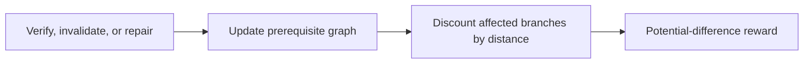
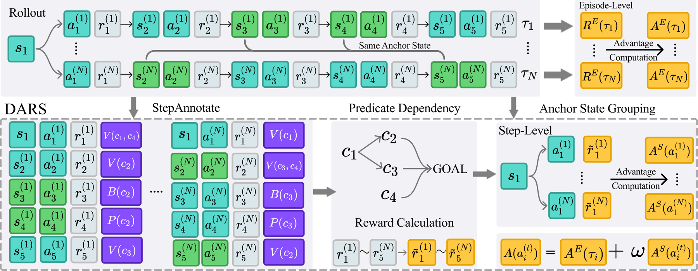

# DARS: Dependency-Aware Reward Shaping for Agentic Reinforcement Learning

<!-- source-sha256: 132d50a031704e55e453fc77b950da71e633bd5cb3ced9976c222d68f1b665c6 -->

[简体中文](README.md)

> L1 dependency decay, invalidation/repair and potential differences; no 1.5B–8B training.

## Paper information

| Field | Details |
|---|---|
| Paper | [arXiv 2610.01207](https://arxiv.org/abs/2610.01207) |
| Institution | University of Illinois Urbana-Champaign (first author). |
| First public release | 2026-10-01 (arXiv v1) |
| Author code | The [official placeholder](https://github.com/JianhuiWei7/DARS) said the implementation was in preparation as of 2026-10-02; interface notes are not released implementation. |
| Local adapter or method key | `dars` |
| Local reproduction code | [`src/auto_research/post_training/latest_20261002.py`](https://github.com/daiwk/auto-research/blob/main/src/auto_research/post_training/latest_20261002.py) |

## Paper method and evidence

Represent progress with a prerequisite graph of predicates. Verification, invalidation, and repair update it. The nearest broken dependency discounts prior credit by graph distance without penalizing independent branches.

<!-- paper-figure:start -->
### Original paper figure

The original figure shows the paper mechanism. From the [original paper](https://arxiv.org/abs/2610.01207); copyright remains with the authors.
<!-- paper-figure:end -->

### Core equation

$r_t=\Phi(s_{t+1})-\Phi(s_t)$; invalidated dependency discounts predicate weight by $\gamma^{d}$.

### Reported results

The paper reports up to 10 points over GiGPO on matched-budget ALFWorld and evaluates WebShop, Search-R1, AIME and tool-free reasoning.

## Local reproduction

Compare with the corresponding operator disabled or in its default state. [Three-seed metrics](metrics/mechanism-seeds42-44.json) are diagnostic_only=true: they verify execution and invariants, not formal gains or capability ranking.
