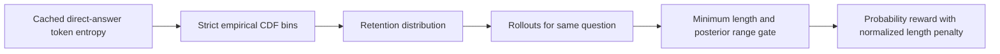
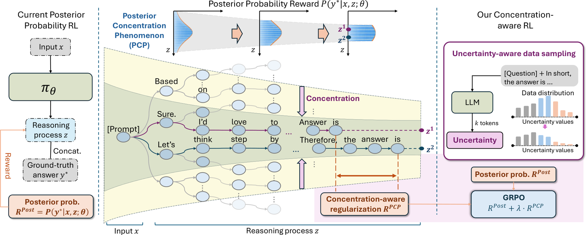

# RLCPR: Probability Rewards Under Posterior Concentration

<!-- source-sha256: 27ced7148330d740dfec46b030f7840700b0956a9b46b9f511ab7c6d7b0e01bf -->

[简体中文](README.md)

> **L1 reward and curriculum diagnostic.** Implements the concentration gate, length penalty, and low-entropy sampling distribution, not full LM RL.

## Paper information

| Field | Value |
| --- | --- |
| Paper | [arXiv 2610.01458](https://arxiv.org/abs/2610.01458) |
| Affiliation | National University of Singapore, first author Shiu-Hong Kao |
| First public release | 2026-10-01 (arXiv v1) |
| Authors' code | None found in full-text review on 2026-10-04. |
| Adapter | `rlcpr` mechanism API |
| Local code | [oct04_objectives.py](https://github.com/daiwk/auto-research/blob/main/src/auto_research/post_training/oct04_objectives.py) |

## Original paper

### Background and contribution

When rollout answer posteriors are close, probability rewards struggle to discourage verbosity. RLCPR applies relative length penalty only if all responses are long and their posteriors concentrated. Mean direct-answer token entropy stratifies data so retained examples favor low uncertainty.

<!-- paper-figure:start -->
### Key figure from the paper

Mechanism overview from the [paper](https://arxiv.org/abs/2610.01458); copyright belongs to the authors.
<!-- paper-figure:end -->

### Core equations

Use strict $F(h_i)=N^{-1}\sum_j\mathbf1[h_j<h_i]$ so ties are consistent. Bin weight is $1-r_{bin(i)}$; return the normalized expected retention distribution for caller sampling.

$$
I_g=\mathbf1[\min_i L_{gi}>\delta]\mathbf1[\max_i p_{gi}-\min_i p_{gi}<\alpha],
$$

$$
r_{gi}=p_{gi}-\lambda I_g\frac{L_{gi}-\min_j L_{gj}}{\max(\max_jL_{gj}-\min_jL_{gj},1)}.
$$

$\delta$ is a batch length quantile and $\alpha$ a batch quantile of within-group posterior range. Equalities do not activate the gate; this is not a global fixed penalty.

### Paper results

Table 1 reports gains over same-backbone RLPR on six of seven benchmarks, average accuracy +1.8 percentage points and improved training-token efficiency. Task Avg@k sample counts vary, so these are not uniform single-draw accuracy. No production A/B.

## Local reproduction

`PYTHONPATH=src python scripts/run_oct04_seven_papers.py`: short diffuse groups are unpenalized; in long concentrated groups longest penalty is −1 and shortest zero. Low/high entropy retention is about 0.333/0.100. See [mechanism metrics](metrics/mechanism-seeds42-44.json). Reject invalid probabilities, negative lengths, and nonfinite values; detach rewards. Equal entropy gives a uniform distribution. Multiple seeds do not make deterministic equations statistical evidence.

## Reproduction limits

Callers supply real entropy, posterior, length, and policy updates. Handcrafted inputs test equations, not reasoning or RL improvements. No formal GPU or Evolve integration.
