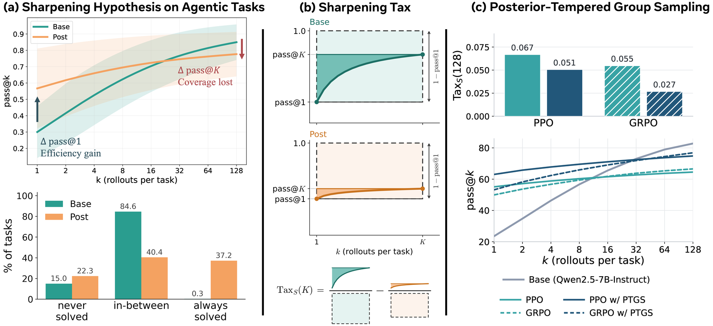

# Sharpening Tax in Post-Training

<!-- source-sha256: 600a27d376f6d835a0e2ebe74ff708504256df05769c1b6162d3fe5de6a628a8 -->

[简体中文](README.md)

> **L1 core-mechanism diagnostic.** Computes the coverage gap under a fixed budget, without running Meta models or agent environments.

## Paper information

| Field | Details |
|---|---|
| Paper | [Sharpening Tax in Post-Training](https://arxiv.org/abs/2610.01509) |
| Organization | First-author affiliations: Meta Superintelligence Labs / University of Wisconsin–Madison |
| First public release | 2026-10-01 (arXiv v1) |
| Authors' code | [changdaeoh/sharpening-tax](https://github.com/changdaeoh/sharpening-tax) is public. |
| Adapter / method | `sharpening-tax` |
| Local reproduction code | [`src/auto_research/post_training/latest_20261003.py`](https://github.com/daiwk/auto-research/tree/main/src/auto_research/post_training/latest_20261003.py) |

## Original paper

### Motivation and method

Compare coverage of the base and post-trained policies under the same sampling budget. Posterior-tempered group sampling adjusts temperature by estimated difficulty to balance pass@1 and coverage.

~~~mermaid
flowchart LR
  I[Public input and current state] --> M[sharpening-tax mechanism]
  M --> A[Auditable intermediates]
  A --> O[Output or state update]
~~~

<!-- paper-figure:start -->
### Key figure from the paper

> **Figure 1:** Training pipeline and key optimization steps. From the [original paper](https://arxiv.org/abs/2610.01509); copyright remains with the authors. Click the image for the source.
<!-- paper-figure:end -->

### Core equation

$Tax_K=Coverage_K(base)-Coverage_K(post)$.

### Paper results

The tax appears broadly across 14 checkpoint pairs and three agent benchmarks. PTGS improves both single-attempt accuracy and coverage.

## Local reproduction

> **Local comparison:** The baseline disables the mechanism or uses default state; the treatment executes the defining operator. L1 reports no formal relative improvement, and relative percentages are not applicable.

- [Three-seed diagnostic](metrics/mechanism-seeds42-44.json)
- `diagnostic_only=true`, ineligible for formal capability ranking.

## Reproduction boundaries

The fixed-budget coverage-gap metric runs. Meta models and agent environments are not executed.
