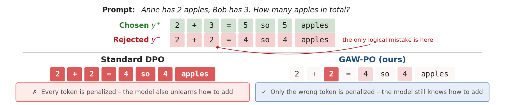

# GAW-PO: Preference Optimization with Gradient-Aligned Token Weights

<!-- source-sha256: 55f873d81174d19b5e91e731d4990796b4dcf44fd3d7b60d394c2cacceb85edf -->

[简体中文](README.md)

> L1 gradient-alignment weighting diagnostic; no LoRA/DPO training.

## Paper information

| Field | Details |
|---|---|
| Paper | [arXiv v1](https://arxiv.org/abs/2610.01511) |
| Institution | National University of Science and Technology POLITEHNICA Bucharest (first author). |
| First public release | 2026-10-01 (arXiv v1) |
| Author code | No public author implementation found as of 2026-10-03. |
| Local adapter or method key | `gaw-po` |
| Local reproduction code | [`src/auto_research/post_training/latest_20261003.py`](https://github.com/daiwk/auto-research/tree/main/src/auto_research/post_training/latest_20261003.py) |

## Paper method and evidence

Weight rejected-response tokens by their gradient alignment with the preferred update direction. Tokens that better support preferred behavior receive less penalty.

<!-- paper-figure:start -->
### Original paper figure

Figure 1 shows the key components and their relationships. From the [original paper](https://arxiv.org/abs/2610.01511); copyright remains with the authors.
<!-- paper-figure:end -->

### Core equation

$w_t=1-[cos(g_t,g_+)]_+$.

### Reported results

The authors report a 0.97-point average improvement over DPO on 11 math, reasoning, code, and QA benchmarks.

## Local reproduction

Compare with the mechanism disabled/default state. The [three-seed diagnostic](metrics/mechanism-seeds42-44.json) is `diagnostic_only=true`; no formal relative improvement or capability ranking.
