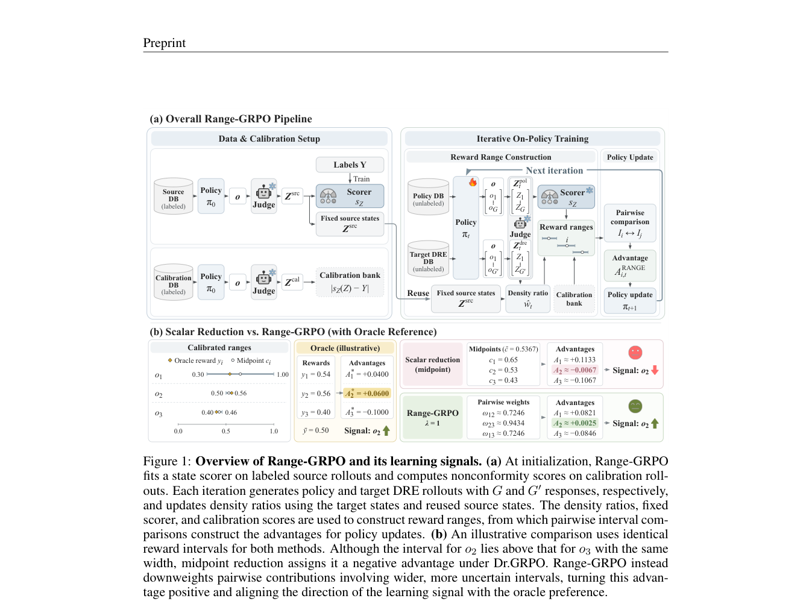

# Range-GRPO: Policy Optimization via Pairwise Relations among Reward Intervals

<!-- source-sha256: 7ea48b6da634558e52ef0772673162a5be209bb5590d7500f855d1537c6e02d4 -->

[简体中文](README.md)

> **L1 mechanism diagnostic.** Pairwise interval relations and point-limit behavior, no fitted conformal judge or large-model GRPO.

## Paper information

| Field | Value |
| --- | --- |
| Paper | [arXiv 2610.01548](https://arxiv.org/abs/2610.01548) |
| Affiliations | Yonsei University, first author's affiliation |
| First public release | 2026-10-01 (arXiv v1) |
| Authors' code | No public author implementation found as of 2026-10-02. |
| Adapter / method | `range-grpo` |
| Local code | [`src/auto_research/post_training/latest_20261002.py`](https://github.com/daiwk/auto-research/blob/main/src/auto_research/post_training/latest_20261002.py) |

## Original paper

### Background and contribution

Use conformal reward intervals instead of point judge scores. Give a directional signal only for determinately ranked pairs; overlapping intervals do not create spurious preference.

<!-- paper-figure:start -->
### Key figure from the paper

Original Range-GRPO protocol diagram. From the [paper](https://arxiv.org/abs/2610.01548); copyright belongs to the authors. Not a local result.
<!-- paper-figure:end -->

### Core mechanism

$A_i=G^{-1}\sum_j relation([l_i,u_i],[l_j,u_j])$. Collapsing intervals to points recovers DR-GRPO.

### Paper results

The paper reports the best mean in- and out-of-distribution results among evaluated semi-supervised methods, with fewer training resources.

## Local reproduction

Compare disabled/default to enabled. [Three-seed diagnostics](metrics/mechanism-seeds42-44.json) check invariant, gradient, and state behavior, not paper-scale effects (`diagnostic_only=true`).

## Reproduction limits

Pairwise interval/point-limit checks only; no judge fitting or large-model GRPO.
