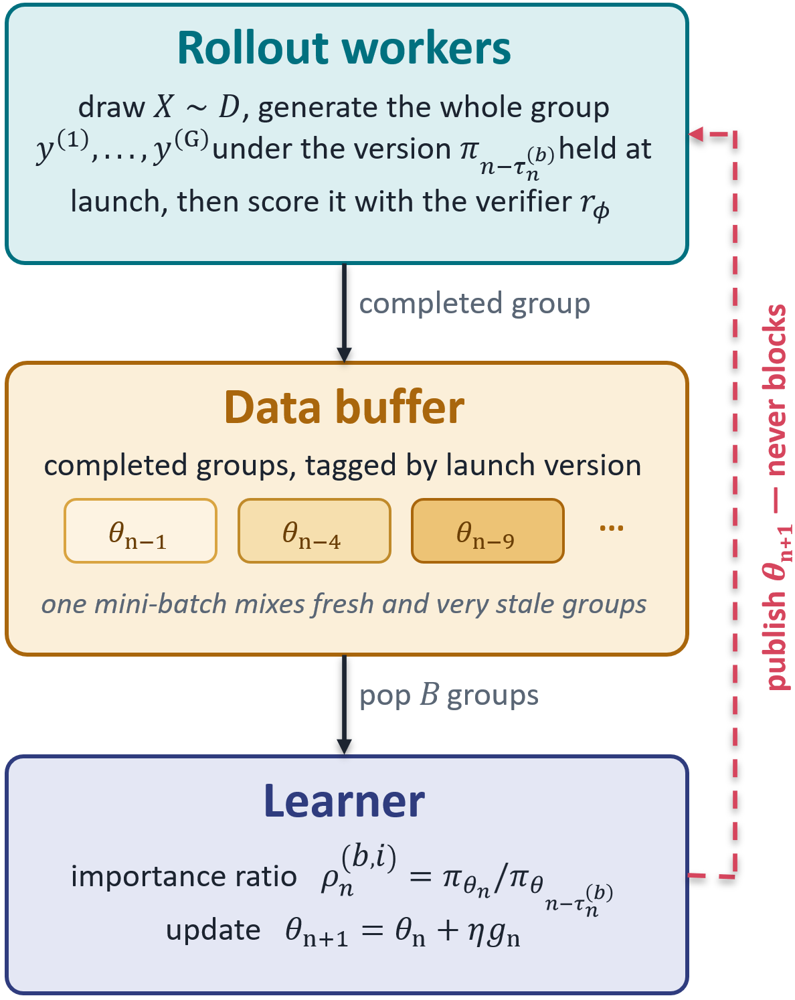

# Asynchronous LLM Post-Training: Group-Mass Capping and Convergence Analysis

<!-- source-sha256: 2ddf4a7254be0064176e2adfeba8299a9258cc99ac73c087f15533d54e6c7b44 -->

[简体中文](README.md)

> **L1 core-mechanism diagnostic.** Executes group-mass capping, not an asynchronous RL cluster.

## Paper information

| Field | Details |
|---|---|
| Paper | [Asynchronous LLM Post-Training: Group-Mass Capping and Convergence Analysis](https://arxiv.org/abs/2610.01896) |
| Organization | First-author affiliation: The Ohio State University |
| First public release | 2026-10-01 (arXiv v1) |
| Authors' code | No public author implementation was found as of 2026-10-03. |
| Adapter / method | `gmc-grpo` |
| Local reproduction code | [`src/auto_research/post_training/latest_20261003.py`](https://github.com/daiwk/auto-research/tree/main/src/auto_research/post_training/latest_20261003.py) |

## Original paper

### Motivation and method

Scale asynchronous-rollout importance ratios uniformly within a group to cap their total mass. Under a common second-moment guarantee, this reduces the persistent bias of trajectory-wise clipping.

~~~mermaid
flowchart LR
  I[Public input and current state] --> M[gmc-grpo mechanism]
  M --> A[Auditable intermediates]
  A --> O[Output or state update]
~~~

<!-- paper-figure:start -->
### Key figure from the paper

> **Figure 1:** Overview of the paper's method and its key components. From the [original paper](https://arxiv.org/abs/2610.01896); copyright remains with the authors. Click the image for the source.
<!-- paper-figure:end -->

### Core equation

$w_i=r_i\min(1,C/\sum_jr_j)$.

### Paper results

The paper reports beating stable baselines in Qwen3 reasoning experiments under high staleness.

## Local reproduction

> **Local comparison:** The baseline disables the mechanism or uses default state; the treatment executes the defining operator. L1 reports no formal relative improvement, and relative percentages are not applicable.

- [Three-seed diagnostic](metrics/mechanism-seeds42-44.json)
- `diagnostic_only=true`, ineligible for formal capability ranking.

## Reproduction boundaries

Group-mass capping executes locally. No asynchronous RL cluster was built.
