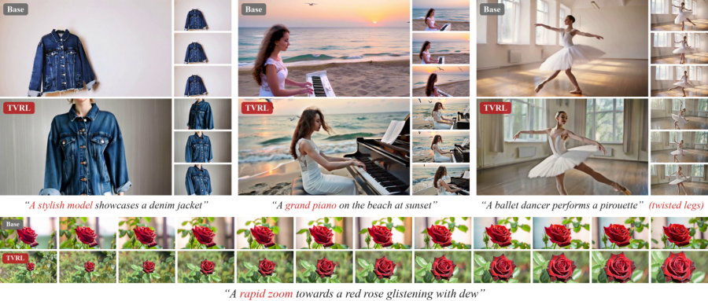

# Token-Level Video Reinforcement Learning

<!-- source-sha256: ce075a35eeddf757c5bd3590b394c1320c2dbbf9363328de5b7f41402b00aac6 -->

[简体中文](README.md)

> **L1 core-mechanism diagnostic.** Executes gradient-credit normalization without training a video diffusion model.

## Paper information

| Field | Details |
|---|---|
| Paper | [Token-Level Video Reinforcement Learning](https://arxiv.org/abs/2610.01973) |
| Organization | No first-author affiliation is listed on the paper's first page. |
| First public release | 2026-10-01 (arXiv v1) |
| Authors' code | No public author implementation was found as of 2026-10-03. |
| Adapter / method | `tvrl` |
| Local reproduction code | [`src/auto_research/post_training/latest_20261003.py`](https://github.com/daiwk/auto-research/tree/main/src/auto_research/post_training/latest_20261003.py) |

## Original paper

### Motivation and method

A frozen VLM's video-input gradients identify which generated tokens most affect reward. Group advantage is then redistributed densely to tokens.

~~~mermaid
flowchart LR
  I[Public input and current state] --> M[tvrl mechanism]
  M --> A[Auditable intermediates]
  A --> O[Output or state update]
~~~

<!-- paper-figure:start -->
### Key figure from the paper

> **Figure 1:** Training pipeline and key optimization steps. From the [original paper](https://arxiv.org/abs/2610.01973); copyright remains with the authors. Click the image for the source.
<!-- paper-figure:end -->

### Core equation

$c_t=\|\partial R/\partial z_t\|/mean_t\|\partial R/\partial z_t\|$.

### Paper results

Video-generation evaluations report better prompt following and temporal quality than scalar GRPO.

## Local reproduction

> **Local comparison:** The baseline disables the mechanism or uses default state; the treatment executes the defining operator. L1 reports no formal relative improvement, and relative percentages are not applicable.

- [Three-seed diagnostic](metrics/mechanism-seeds42-44.json)
- `diagnostic_only=true`, ineligible for formal capability ranking.

## Reproduction boundaries

Gradient-credit normalization runs locally; no video diffusion model was trained.
