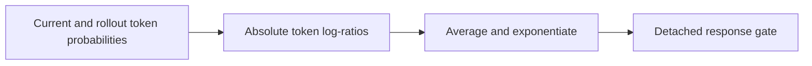
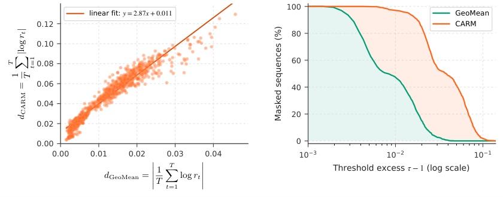

# CARM: Cancellation-Aware Response Masking for LLM Reinforcement Learning

<!-- source-sha256: 3ad3edb69fe2e8eac89dac5bcd657a421e4e8be11f231a5a711ff8c770ab9257 -->

[简体中文](README.md)

> L1 detached response gate; no Qwen3.5 training.

## Paper information

| Field | Details |
|---|---|
| Paper | [arXiv v1](https://arxiv.org/abs/2610.02039) |
| Institution | Moore Threads AI (first author). |
| First public release | 2026-10-01 (arXiv v1) |
| Author code | No public author implementation found as of 2026-10-03. |
| Local adapter or method key | `carm` |
| Local reproduction code | [`src/auto_research/post_training/latest_20261003.py`](https://github.com/daiwk/auto-research/tree/main/src/auto_research/post_training/latest_20261003.py) |

## Paper method and evidence

Take absolute values of per-token current/rollout log-ratios before averaging. Positive and negative drifts can otherwise cancel in a sequence-level geometric mean.

<!-- paper-figure:start -->
### Original paper figure

Figure 3 illustrates the cancellation-aware scoring refinement. From the [original paper](https://arxiv.org/abs/2610.02039); copyright remains with the authors.
<!-- paper-figure:end -->

### Core equation

$s=\exp(T^{-1}\sum_t|\log r_t|)$; retain the response only if $s\le\tau$.

### Reported results

The paper reports up to +3.13 points on AIME/BeyondAIME mean@16 and +2.88 pass@1 points across four coding benchmarks.

## Local reproduction

Compare against the mechanism disabled or in its default state. The [three-seed diagnostic](metrics/mechanism-seeds42-44.json) is `diagnostic_only=true`; no formal relative gain or capability ranking.
