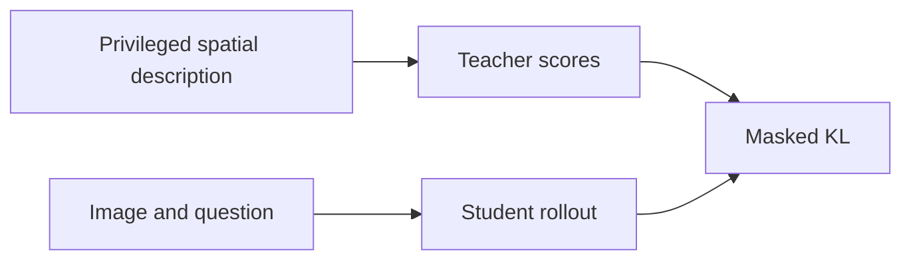
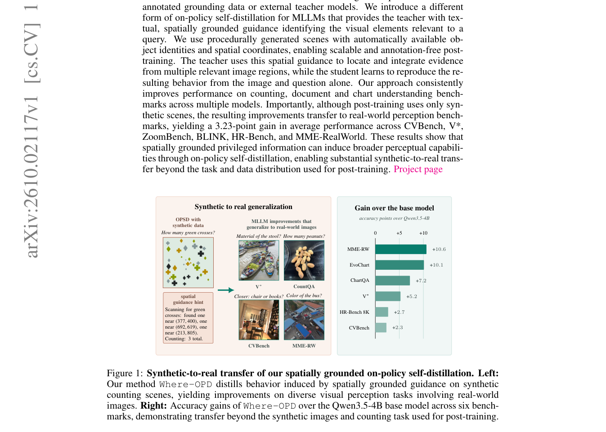

# Where-OPD: Spatially Guided On-Policy Self-Distillation of MLLMs with Synthetic Scenes

<!-- source-sha256: a468a8d337cc6cfa34ccf92edac071aa8b38451fa48fa557dd90f537cdca6422 -->

[简体中文](README.md)

> **L1 mechanism diagnostic.** Spatially masked teacher KL, without scene generation or an MLLM.

## Paper information

| Field | Value |
| --- | --- |
| Paper | [arXiv 2610.02117](https://arxiv.org/abs/2610.02117) |
| Affiliations | Valeo.ai, first author's affiliation |
| First public release | 2026-10-01 (arXiv v1) |
| Authors' code | [Where-OPD](https://github.com/sirkosophia/Where-OPD) |
| Adapter / method | `where-opd` |
| Local code | [`src/auto_research/post_training/latest_20261002.py`](https://github.com/daiwk/auto-research/blob/main/src/auto_research/post_training/latest_20261002.py) |

## Original paper

### Background and contribution

Procedural scenes supply object identities and coordinates. Give the teacher textual spatial privilege while the student sees only image and question. Distill teacher scores on the student's on-policy tokens.

<!-- paper-figure:start -->
### Key figure from the paper

Original paper diagram of spatially guided distillation. From the [paper](https://arxiv.org/abs/2610.02117); copyright belongs to the authors. Not a local result.
<!-- paper-figure:end -->

### Core mechanism

$L=\sum_t m_t KL(\pi_T(\cdot|x,g),\pi_S(\cdot|x))/\sum_tm_t$.

### Paper results

Training only on synthetic scenes reportedly gains 3.23 points on average across six real vision benchmarks.

## Local reproduction

Compare disabled/default and enabled mechanisms. [Three-seed diagnostics](metrics/mechanism-seeds42-44.json) are `diagnostic_only=true`, checking invariant, gradient, or state behavior only.

## Reproduction limits

No synthetic scenes were generated locally and no MLLM was loaded. Random logits are not visual results.
