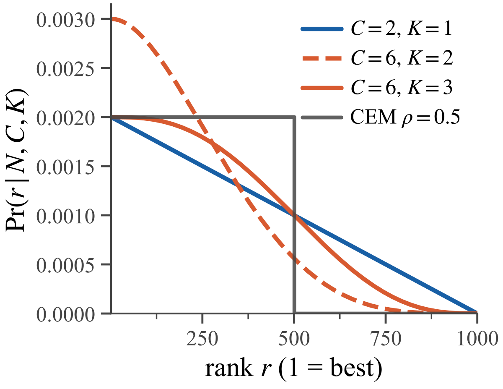

# Follow the Winners: conservative policy improvement from elite trajectories

<!-- source-sha256: 8c6998f6e8910f43fa0eafce9c926e1d3149e2c07bd91a1fcfa91355ea5db28f -->

[简体中文](README.md)

> **L1 core-mechanism diagnostic.** Implements Algorithm 2's FIFO trajectory pool, repeated minibatch top-$K$ selection, and KL-regularized cross-entropy policy projection. Runs only on a synthetic two-armed bandit, not the paper's LLM-agent training.

## Paper information

| Field | Details |
|---|---|
| Paper | [arXiv 2610.03361 v1](https://arxiv.org/abs/2610.03361) |
| Organization | Trent AI Limited (first author Joery A. de Vries; collaborators also affiliated with the University of Cambridge) |
| First public release | 2026-10-02 (arXiv v1; announced October 5) |
| Authors' code | **Not released.** The reproducibility statement says code, models, and data will not be released before acceptance and internal legal review. |
| Local adapter | `follow-the-winners`, standalone L1 mechanism API, not registered as a full reproduce adapter |
| Local reproduction code | [`src/auto_research/post_training/follow_the_winners.py`](https://github.com/daiwk/auto-research/blob/main/src/auto_research/post_training/follow_the_winners.py); [`scripts/run_follow_the_winners_20261005.py`](https://github.com/daiwk/auto-research/blob/main/scripts/run_follow_the_winners_20261005.py) |

## Original paper

### Motivation and method

In stateful tool environments, repeatedly generating equivalent rollouts for one prompt can be expensive, while a PPO critic requires extra model resources. FTW uses no value estimates and does not need GRPO-style groups for the same question. It stores real trajectories from recent policies in a FIFO pool, repeatedly samples minibatches, imitates only the $K$ highest-return trajectories in each batch, and constrains updates with KL. Reselection counts naturally weight past trajectories, rather than cutting the entire pool once.

~~~mermaid
flowchart LR
  A[Current policy collects trajectories] --> B[FIFO replay pool]
  B --> C[J uniform draws of C trajectories]
  C --> D[Keep top K by terminal return]
  D --> E[Cross-entropy over selected trajectories, including repeats]
  E --> F[Add policy-reference KL and update]
  F --> A
~~~

<!-- paper-figure:start -->
### Key figure from the paper

> **Figure 1:** Probability of retaining a trajectory by return rank under different $C,K$. $C$ controls concentration and larger $K$ softens selection. From the [original paper](https://arxiv.org/abs/2610.03361); copyright remains with the authors.
<!-- paper-figure:end -->

### Core equation

For a pool of capacity $N$, rank $r=1$ has the highest return. Sampling $C$ without replacement and retaining $K$ gives the normalized rank occupancy of Equation (5):

$$
P(r\mid N,C,K)=\frac{1}{K\binom{N}{C}}\sum_{k=1}^{K}\binom{r-1}{k-1}\binom{N-r}{C-k}.
$$

The implementation checks that the probabilities sum to one. $K=C$ reduces to uniform sampling, and $C=N$ to full-pool CEM. Training averages action log likelihood across $J$ batches of elites and adds KL against the reference policy. **The same trajectory can be selected in multiple batches** as part of the original selection distribution.

### Paper results

On Search-R1 with Qwen2.5-3B-Instruct, the paper reports 35.46% ± 0.15% exact match, versus PPO and GRPO baselines of 32.5% and 33.6%. Sokoban results are close to PPO/GRPO in some $(C,K)$ settings, but collapse occurred with $K=3,C=5$. With many tied binary rewards, selection can mistakenly imitate failures. These are paper results, not local measurements. No production online A/B test is reported.

## Local reproduction

~~~bash
PYTHONPATH=src python scripts/run_follow_the_winners_20261005.py
python -m pytest tests/test_follow_the_winners_20261005.py
~~~

The deterministic three-seed [local artifact](metrics/bandit-seeds42-44.json) reports that the probability of selecting the optimal arm in the synthetic continuous-reward two-armed bandit rises from 0.5 to approximately 0.968. This is an **instructional-scale mechanism check**, not a comparison with Search-R1. Tests also cover Equation (5) normalization, repeat elite selection, FIFO expiration, and gradient direction.

## Reproduction boundaries

The implementation did not train Qwen, run Sokoban or Search-R1, or compare with PPO/GRPO at matched budget. Known bandit means are diagnostic only, not validation/test tuning or capability evaluation. The artifact is `diagnostic_only=true` and `formal_comparison=false`, ineligible for public capability claims or evolve promotion. A formal comparison would need actual tool trajectories and reproducible terminal returns, matched sampling budgets, and multi-seed baselines. A claimed CUDA path would also need A100/A30 execution and a sanitized receipt.
