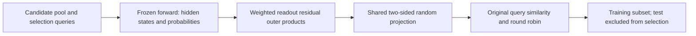
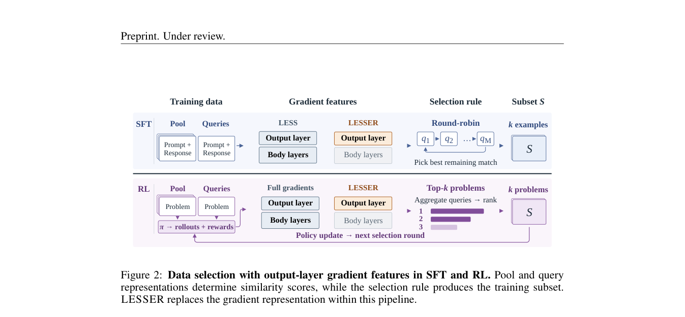

# LESSER: Post-Training Data Selection with Output-Layer Gradients

<!-- source-sha256: efd0a45a81ae7b58f504fed90763d336a2d67227271808055de87e951c19e804 -->

[简体中文](README.md)

> **L1 feature and selection diagnostic.** Output-layer gradients, two-sided random projection, and unchanged round-robin selection are implemented. No claim of reproducing LLM fine-tuning, RL, teacher selection, or speedups.

## Paper information

| Field | Value |
| --- | --- |
| Paper | [arXiv 2610.03702 v1](https://arxiv.org/abs/2610.03702) |
| Affiliation | University of Pennsylvania; first author Lyuxin David Zhang |
| First public release | 2026-10-02 (arXiv v1; announced October 5) |
| Authors' code | No public code found in official HTML as of 2026-10-05. |
| Adapter | `lesser` mechanism API, not a registered full reproduction |
| Local code | [lesser.py](https://github.com/daiwk/auto-research/blob/main/src/auto_research/post_training/lesser.py); [runner](https://github.com/daiwk/auto-research/blob/main/scripts/run_lesser_20261005.py) |

## Original paper

### Background and contribution

Targeted data selection often computes per-example full gradients for candidates and target queries. LESSER replaces **features**, not the selector: one forward yields hidden states and probabilities, from which output gradients are calculated analytically. SFT, RL question selection, and teacher selection rules can remain unchanged.



<!-- paper-figure:start -->
### Key figure from the paper

[](https://arxiv.org/pdf/2610.03702#page=4)

Original workflow from the [paper](https://arxiv.org/abs/2610.03702); copyright belongs to the authors.
<!-- paper-figure:end -->

### Core equations

For fixed token weights $\alpha_t$, Proposition 1 gives

$$
g_p=\sum_t\alpha_t\bigl(\operatorname{softmax}(Wh_t)-e_{y_t}\bigr)h_t^\top.
$$

Appendix B.2 shares fixed Rademacher matrices $\Pi_1,\Pi_2$ across candidate/query features. Project per-token residuals and states before constructing a full $|V|\times d$ gradient:

$$
\phi_p=\frac{\operatorname{vec}(\Pi_1g_p\Pi_2)}{\|\Pi_1g_p\Pi_2\|_F}.
$$

Treat the output layer as an independent readout; tied embeddings can also affect hidden states, so the full gradient is not this expression. Zero weights contribute nothing; RL may use signed advantages. Use validation or target proxy queries, not held-out test for selection.

### Paper results

Feature extraction FLOPs were 9.7×/3.0× lower than full gradients for SFT/RL. Across four LLMs, five tasks, and three budgets, LESSER and LESS averaged an absolute difference of 1.3 points. Workflows also differ outside features. No production A/B reported; these are not local timings.

## Local reproduction

```bash
PYTHONPATH=src python scripts/run_lesser_20261005.py
python -m pytest tests/test_lesser_20261005.py
```

Three seeds compare analytic gradients to independent-readout autodiff and per-token projection to full-gradient projection, plus duplicate-free round robin. See [mechanism results](metrics/mechanism-seeds42-44.json). Tests cover signed and zero weights, shapes, and budgets.

## Reproduction limits

Hidden states and logits are fixed random tensors for deterministic formula/selector checks, not real LLM runs on Tulu V2, GSM8K, or A100 throughput. `diagnostic_only=true`, no formal dashboard or Evolve gains. L2 would need pinned public checkpoints/data, query/test isolation, matched-budget LESS/random controls, and multi-seed training; advertised CUDA would require an A100/A30 receipt.
