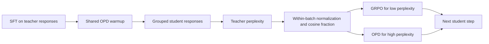
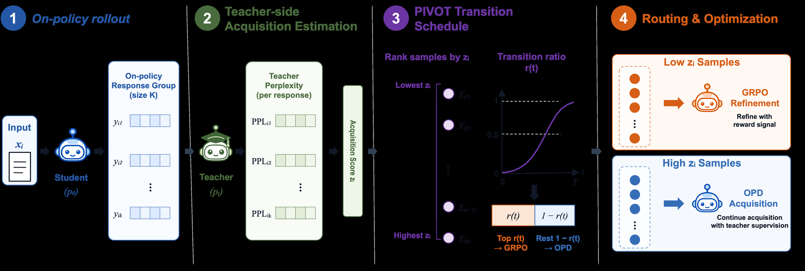

<!-- source-sha256: 0795760b245dfe5c214b81658e18ef86e61c105de30e5ea739a9c62deb5a4601 -->

[简体中文](README.md) · English

# PIVOT: Switching gradually from distillation to RL by teacher perplexity

> Shared warmup, sample-level routing, and resets for three recipes ran on A100. The eight-question diagnostic shows no accuracy gain and does not reproduce the paper's capabilities.

## Paper information

| Field | Details |
|---|---|
| Paper | [PIVOT](https://arxiv.org/abs/2610.11167) |
| Institutions | Ping An Technology / University of Science and Technology of China (first author Heng Li) |
| First public release | 2026-10-08 (arXiv v1) |
| Original source code | No public author repository found. |
| Local adapter | `pivot` |
| Local reproduction code | `src/auto_research/post_training/pivot_checkpoint.py`, `pivot_intent.py`, `oct11_objectives.py`; entry point `scripts/run_pivot_checkpoint.py` |

## Original paper summary

### Background and main changes

Small domain models need both teacher knowledge and task rewards. Switching every example from distillation to RL at once can remove teacher supervision from hard examples too early. PIVOT computes teacher perplexity on student-generated responses, moving low-perplexity questions to GRPO first and keeping high-perplexity questions on OPD.



<!-- paper-figure:start -->
### Key figure from the paper

[](https://arxiv.org/html/2610.11167v1/figs/pivot_method.png)

> **Figure 1:** Overall design and components. From the [paper](https://arxiv.org/abs/2610.11167); copyright belongs to the authors. Click for the source.
<!-- paper-figure:end -->

### Core equations

Response perplexity is $\exp(-\sum_t\log p_T(y_t|x,y_{<t})/|y|)$. Average over the responses for each question, then z-score within the batch. The RL fraction at step $t$ is $r(t)=(1-\cos(\pi t/T))/2$. Route the lowest $\lfloor r(t)B\rfloor$ question scores to GRPO and apply full-vocabulary $KL(p_T\|p_S)$ to the rest. GRPO sums over response tokens, averages within groups, and retains frozen-reference KL regularization.

### Offline and online results

[Paper Table 1](https://arxiv.org/html/2610.11167v1#S3) reports 480 post-warmup updates. Banking77: PIVOT 80.26% versus fixed OPD→GRPO 78.05%; HWU64: 85.04% versus 83.09%. These are official test scores, not comparable to the local short run. No production A/B test is reported.

## Local reproduction

The student is Qwen2.5-0.5B-Instruct and the teacher is 7B-Instruct. Local runs train q/v LoRA rather than full parameters. All recipes share two rounds of teacher-response SFT, initial OPD warmup, and the same initial adapter. Reset optimizer and random seed for continuous OPD, fixed halfway switching, and sample-level PIVOT.

```bash
python scripts/prepare_pivot_banking77.py --help
python scripts/run_pivot_checkpoint.py --help
```

### Data protocol and results

Read only official Banking77 `train.csv`. Deduplicate and sample 5 training and 1 validation example per class with a fixed seed, 385/77 total. The runner verifies the manifest, revision, hashes and non-overlap. The 77 class labels are the public task definition, not answers to current questions. Train labels go only to external rewards; validation labels go only to external scoring. The official test set is unused.

A100 uses fixed 0.5B student and 7B teacher, 8 training / 8 validation examples, two teacher-SFT rounds, 2 shared OPD warmup steps and 8 steps per arm, batch=2, group=2 and at most 512 tokens. Initial, post-warmup and all final accuracies are 0%. Final parsing rate is 37.5%; every arm has 100% validation EOS completion. There is no observed local gain.

| Recipe | Adapter displacement L2 | Actual effective updates | Questions routed to GRPO | GRPO groups with reward variation |
|---|---:|---:|---:|---:|
| Continuous OPD | 0.004158 | 8 | 0 | 0 |
| Fixed halfway switch | 0.003494 | 8 | 8 | 3 |
| PIVOT | 0.003952 | 8 | 6 | 4 |

PIVOT steps 4–7 have both OPD and GRPO questions, with all switching at the last step. Equal-reward groups may have only reference-KL gradients, so not every effective update comes from task reward. All training responses complete with EOS under this budget. See [actual metrics](metrics/checkpoint-a100-seed42.json) and [sanitized GPU receipt](../../gpu-validations/pivot-a100-20261011.json).

### Code map and limits

`pivot_intent.py` implements structured prompts, intent parsing, correctness/candidate-consistency/format rewards, and data splitting. `oct11_objectives.py` implements perplexity routing and the two objectives. `pivot_checkpoint.py` runs shared warmup, frozen reference, resets, training and evaluation. Projection padding between Qwen sizes is not vocabulary: verify the full tokenizer vocabulary matches before dropping only rows without corresponding tokens. Top-k distributions cannot stand in for full-vocabulary KL.

The local protocol uses label names without the authors' Banking77 category descriptions. The switch point is not selected on test, and all recipes use learning rate 1e-6 after warmup. A bounded single-seed LoRA run tests the mechanism, not the paper's 480 steps, full-parameter training or HWU64 gains. Pure GRPO with equal rewards may make no updates; rewards must not be altered to manufacture gradients. Record EOS completion and truncation separately.
