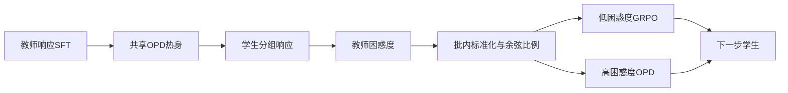
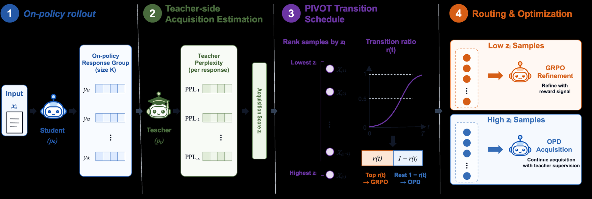

# PIVOT：按教师困惑度从蒸馏逐步切换到 RL

> 共享热身、样本级路由和三配方重置已在 A100 实跑；8 题诊断无准确率提升，不等于原论文能力复现。

## 论文信息

| 字段 | 内容 |
|---|---|
| 论文链接 | [PIVOT](https://arxiv.org/abs/2610.11167) |
| 公司 / 机构 | Ping An Technology / University of Science and Technology of China（第一作者 Heng Li） |
| 首次公开日期 | 2026-10-08（arXiv v1） |
| 原作者代码 | 未找到原作者公开代码仓库 |
| 本地 Adapter | `pivot` |
| 本地复现代码 | `src/auto_research/post_training/pivot_checkpoint.py`、`pivot_intent.py`、`oct11_objectives.py`；入口 `scripts/run_pivot_checkpoint.py` |

## 原始论文总结

### 背景与主要改动

垂直领域的小模型既需要教师传授知识，也需要任务奖励改善最终判断；所有样本同时从蒸馏切换到 RL，可能使困难样本过早失去教师监督。PIVOT 在学生自己的响应上计算教师困惑度，先把低困惑度问题切换到 GRPO，高困惑度问题继续 OPD。



<!-- paper-figure:start -->
### 原论文关键图

[](https://arxiv.org/html/2610.11167v1/figs/pivot_method.png)

> **原论文 Figure 1（关键图）**：展示原论文方法的总体设计和关键组成。图片来自[原论文](https://arxiv.org/abs/2610.11167)，版权归原作者所有；点击图片可查看来源。
<!-- paper-figure:end -->

### 核心公式

响应困惑度为 $\exp(-\sum_t\log p_T(y_t|x,y_{<t})/|y|)$，同一问题的响应组先取均值，再做批内 z-score。第 $t$ 步的 RL 比例为 $r(t)=(1-\cos(\pi t/T))/2$；将最低分的 $\lfloor r(t)B\rfloor$ 个问题路由到 GRPO，其余使用完整词表 $KL(p_T\|p_S)$。GRPO 按响应 token 求和、组内平均，并保留冻结参考的 KL 正则。

### 论文离线与线上效果

[原文表 1](https://arxiv.org/html/2610.11167v1#S3)报告 480 个热身后更新步：Banking77 上 PIVOT 80.26%、固定 OPD→GRPO 78.05%；HWU64 为 85.04% 与 83.09%。这是官方 test 结果，不能与本地短跑直接比较。未报告线上 A/B。

## 本地复现

真实 Qwen2.5-0.5B-Instruct 学生、7B-Instruct 教师，q/v LoRA 而非原文全参数微调。所有配方共享教师响应两轮 SFT、初始 OPD 热身和相同初始 adapter；随后重置 optimizer 与随机种子，分别执行持续 OPD、固定半预算切换及样本级 PIVOT。

```bash
python scripts/prepare_pivot_banking77.py --help
python scripts/run_pivot_checkpoint.py --help
```

### 数据协议与结果

只读取官方 Banking77 `train.csv`，按类抽 5 条训练、1 条验证，共 385/77 条；先去重，再固定 seed 分区。运行器必须核对 manifest、revision、哈希及问题不重叠。完整 77 类标签是公开任务定义，不是当前问题答案；训练答案只供外部奖励，验证答案只供外部评分，official test 不参与本地运行。

A100 使用固定 0.5B 学生 / 7B 教师、8 条训练 / 8 条验证、两轮教师 SFT、2 步共享 OPD 热身、每臂 8 步、batch=2、group=2、最多 512 token。初始与共享热身后准确率都是 0%；三臂最终也都为 0%，最终解析率 37.5%，验证 EOS 完成率均为 100%。本地未观察到收益，不能改写为论文结论。

| 配方 | Adapter 位移 L2 | 实际有效更新步 | 路由到 GRPO 的问题数 | 奖励有差异的 GRPO 组 |
|---|---:|---:|---:|---:|
| 持续 OPD | 0.004158 | 8 | 0 | 0 |
| 固定半预算切换 | 0.003494 | 8 | 8 | 3 |
| PIVOT | 0.003952 | 8 | 6 | 4 |

PIVOT 第 4–7 步真实同时包含 OPD 与 GRPO 问题，最后一步全部切换。等奖励组可能只剩参考 KL 梯度，不能把所有有效更新归因于任务奖励。全部训练响应在此预算内 EOS 完成。见[实际指标](metrics/checkpoint-a100-seed42.json)和[脱敏 GPU 回执](../../gpu-validations/pivot-a100-20261011.json)。

### 代码映射与复现边界

`pivot_intent.py` 实现结构化提示、最终 intent 解析、正确性/候选一致性/格式奖励与数据切分；`oct11_objectives.py` 实现困惑度路由和双目标；`pivot_checkpoint.py` 执行真实共享热身、冻结参考、三臂重置、训练与评测。不同大小 Qwen 的 projection padding 不计入词表：先验证整个 tokenizer 词表一致，再仅丢弃无 token 对应的填充行，不能用 top-k 分布冒充完整词表 KL。

本地使用标签名，未获得作者 Banking77 类别定义；固定切换点不在 test 上选择，三配方热身后均使用 1e-6 学习率。有界少样本、单 seed、LoRA 与短训练只验证机制，不复现原始 480 步/全参数/HWU64 能力收益。等奖励的纯 GRPO 可能无更新，不能修改奖励制造梯度；EOS 完成率与截断必须独立保存。
