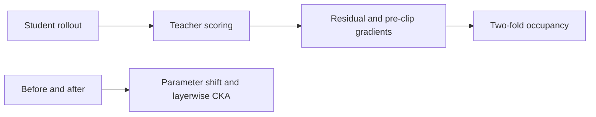
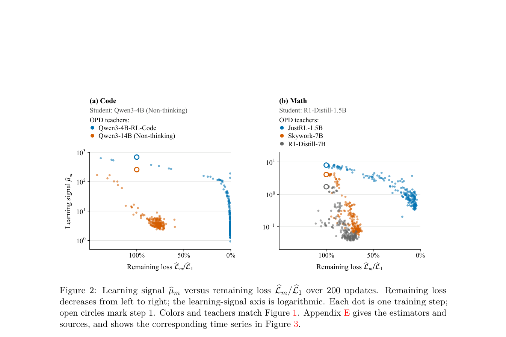

# OPD Learning Signals: Diagnose residual loss and gradient signal

<!-- source-sha256: 6d792a75ff1fd93711b11e8d54d79b7059c03b83cd21828608ee84f7bfa90d21 -->

[简体中文](README.md)

> Diagnostic infrastructure, not an optimizer or a three-step reproduction of the 200-step plateau.

## Paper information

| Field | Details |
|---|---|
| Paper | [Why On-Policy Distillation Sometimes Fails: Vanishing Learning Signals](https://arxiv.org/abs/2610.11247) |
| Institution | University of Pennsylvania; Lei Zhao. |
| First public release | 2026-10-08 (arXiv v1) |
| Author code | [Author code](https://github.com/leizhao7/opd-learning-signals). |
| Local adapter or method key | `opd-learning-signals` |
| Local reproduction code | `src/auto_research/post_training/learning_signals.py`; `scripts/run_opd_learning_signals.py`. |

## Paper method and evidence

Large residual difference can coexist with weak gradients. Track loss, pre-clip gradients, two-fold occupancy, displacement and layerwise CKA. These correlations are not causal.

<!-- paper-figure:start -->
### Original paper figure

Figure 2 compares residual loss and signal proxy across teacher runs; not the local three steps. From the [original paper](https://arxiv.org/abs/2610.11247); copyright remains with the authors.
<!-- paper-figure:end -->

### Core equation

Use $\|g\|^2/(2L)$ only for $L>0$. Two-fold occupancy uses numerator $\frac12(h_0^Tg_1+h_1^Tg_0)$ and denominator $g_0^Tg_1$; nonpositive denominator is invalid. Pool representations by prompt and center across prompts for FP64 linear CKA.

### Reported results

The [200-update paper experiment](https://arxiv.org/html/2610.11247v1) reports mean loss reductions 25.1% and 96.2% for large and self-RL teachers. Small parameter motion and high CKA are observations. No production A/B.

## Local reproduction

Qwen3-4B and public MOPD teacher with q/v LoRA, three steps, eight responses in 2×4 folds, max 128 tokens. Eight independent validation prompts are feature-only. [Guide](../oct11-checkpoint-guide.md).

~~~bash
python scripts/run_opd_learning_signals.py --help
~~~

Use train-derived holdout, not official test. A100 seed 42: residual 0.005854→0.001969, all three pre-clip gradients nonzero, LoRA L2 displacement 0.002472, minimum CKA about 0.999662 across 37 actual locations. [Metrics](metrics/checkpoint-a100-seed42.json), [receipt](../../gpu-validations/opd-learning-signals-a100-20261011.json). Top-16 reweights only within support and truncated residual can be negative. Occupancy sums response log-likelihoods with opposite-fold baseline. Explicitly capture embeddings, all intermediate layers, and final norm; missing layers or bad shapes fail, not interpreted as batch-as-layer. No paired teacher study, multi-seed or full benchmark, or Evolve promotion.
