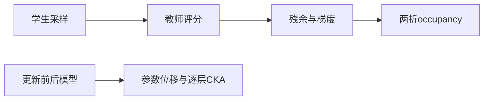
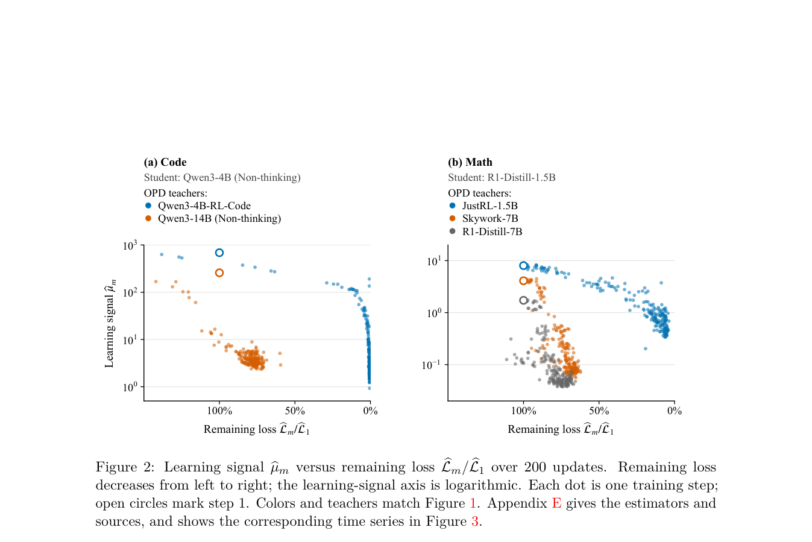

# OPD Learning Signals：残余损失与学习信号诊断

> 这是诊断设施，不是提高效果的新优化算法。3 步实跑不复现论文的 200 步平台期，也不能证明学习失败的原因。

## 论文信息

| 字段 | 内容 |
|---|---|
| 论文链接 | [Why On-Policy Distillation Sometimes Fails: Vanishing Learning Signals](https://arxiv.org/abs/2610.11247) |
| 公司 / 机构 | University of Pennsylvania（第一作者 Lei Zhao） |
| 首次公开日期 | 2026-10-08（arXiv v1） |
| 原作者代码 | [已开源](https://github.com/leizhao7/opd-learning-signals) |
| 本地 Adapter | `opd-learning-signals` |
| 本地复现代码 | `src/auto_research/post_training/learning_signals.py`；入口 `scripts/run_opd_learning_signals.py` |

## 原始论文总结

### 背景与主要改动

OPD 的残余差异可能仍大，但梯度提供的学习信号已变弱。论文同时记录损失、截断前梯度、两折 occupancy 估计、参数位移和逐层表征 CKA；这些是相关性诊断，不是因果证明。



<!-- paper-figure:start -->
### 原论文关键图

[](https://arxiv.org/pdf/2610.11247#page=9)

> **原论文 Figure 2（关键图）**：横轴是剩余损失，纵轴是学习信号代理；比较不同教师的 200 步轨迹。图示关联不能证明信号衰减原因，也不是本库三步诊断。图片来自[原论文](https://arxiv.org/abs/2610.11247)，版权归原作者所有；点击图片可查看来源。
<!-- paper-figure:end -->

### 核心公式

学习信号代理为 $\|g\|^2/(2L)$；$L\leq0$ 时不定义。两折估计用 $g_0^Tg_1$ 作分母，$\frac12(h_0^Tg_1+h_1^Tg_0)$ 作分子；分母非正时不输出有效比例。表征按 prompt 平均，再跨 prompt 中心化，以 FP64 计算线性 CKA。

### 论文离线与线上效果

[原文](https://arxiv.org/html/2610.11247v1)的 200 更新比较中，大教师与 self-RL 教师平均损失降幅分别为 25.1%/96.2%；较小参数变化和高 CKA 是观测，不是失败原因的证明。未报告线上 A/B。

## 本地复现

Qwen3-4B 学生、公开 MOPD 教师、LoRA q/v 更新；3 步，每问题 8 条响应分成 2×4 折，最多生成 128 token。8 个独立验证问题仅用于提取表征，不生成答案。见[运行说明](../oct11-checkpoint-guide.md)。

```bash
python scripts/run_opd_learning_signals.py --help
```

### 数据协议与结果

执行前核验训练集派生 holdout，不读取官方 test。A100 seed 42 实测：残余从 0.005854 降到 0.001969；3 步截断前梯度均非零；LoRA 参数位移 L2 为 0.002472。37 个真实表征位置的 CKA 最低约 0.999662。这里只统计 LoRA 参数，不冒充全模型位移。[指标](metrics/checkpoint-a100-seed42.json)、[GPU 回执](../../gpu-validations/opd-learning-signals-a100-20261011.json)。

### 代码映射与复现边界

核心保留原始概率归一化，Top-16 权重只在支持集内重新归一；截断残余可为负，不强行改成正 KL。occupancy 使用响应 log-likelihood 的 token 总和及相反折基线。

不同 Transformers 版本可能只返回最终隐藏张量。运行器显式采集 embedding、各中间层及最终 norm，验证 37 个位置；不会把 batch 维当成层维。缺层/错形状即失败。未完成大教师与 self-RL 教师的成对比较、多 seed 或完整 benchmark；不作为 Evolve 晋级证据。
