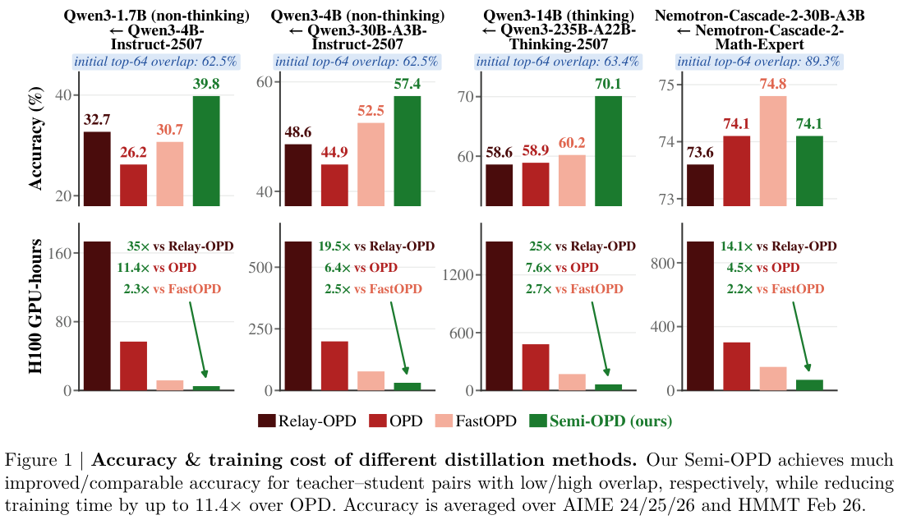

# Semi-OPD: When Do We Need On-Policy Distillation? Distilling on Offline Student Rollouts Is Often Better

<!-- source-sha256: 1f65c586f0ba66b5c472963cca6d27af741e04e6f8d04a889d19219cb9ab7851 -->

[简体中文](README.md)

> Core mechanism. Short-budget runs on real checkpoints validate the training path, not paper-scale capability.

## Paper information

| Field | Details |
|---|---|
| Paper | [Original paper](https://arxiv.org/abs/2610.11291) |
| Organization | First-author affiliations: UCLA / NVIDIA (internship noted in the paper) |
| First public release | 2026-10-08 (arXiv v1) |
| Authors' code | No author-released code was found as of 2026-10-10. |
| Local adapter | `semi-opd` |
| Local reproduction code | [oct10_objectives.py](https://github.com/daiwk/auto-research/blob/main/src/auto_research/post_training/oct10_objectives.py), [oct10_checkpoint.py](https://github.com/daiwk/auto-research/blob/main/src/auto_research/post_training/oct10_checkpoint.py) |

## Original paper

### Motivation and method

The initial student generates responses once. Teacher scores are cached and reused unchanged. Each update recomputes current student probabilities and token advantages; caching old advantages would change the method.

~~~mermaid
flowchart LR
  A[Initial student samples] --> T[Teacher scores once] --> C[Immutable cache] --> S[Current student rescores] --> R[Refresh advantages] --> U[Update student]
~~~

<!-- paper-figure:start -->
### Key figure from the paper

> **Figure 1:** Accuracy and H100 training time at different teacher–student overlaps, including advantages of offline student rollouts and the high-overlap exception. These are paper results, not local accuracy or speed measurements. From the [original paper](https://arxiv.org/abs/2610.11291); copyright remains with the authors.
<!-- paper-figure:end -->

### Core equations

$\mathcal D_0=\{(x,y):y\sim\pi_0\}$ is fixed. Recompute $A_t=\log\pi_T(y_t|s_t)-\log\pi_\theta(y_t|s_t)$ at every step, with objective $-\operatorname{sg}(A_t)\log\pi_\theta(y_t|s_t)$.

### Paper results

Fourteen of 17 teacher–student pairs beat OPD, with gains up to 13.6 percentage points and training speedup up to 11.4×. Top-64 overlap is a diagnostic, not a universal automatic switching threshold. No online A/B test is reported.

## Local reproduction

See the [checkpoint guide](../oct10-checkpoint-guide.md) for installation, data formats, and commands.

The core entry points are `SemiOPDCache / semi_opd_loss / topk_overlap`. For real checkpoint execution use `scripts/run_oct10_post_training.py --objective semi-opd`.

Provide a local checkpoint path, public model ID/revision, public GSM8K train and validation JSONL, data revision, and output directory. See `python scripts/run_oct10_post_training.py --help` for all options. The runner does not automatically download models or upload private data. Teacher and student vocabularies must align token for token. It supports causal LMs with `q_proj` and `v_proj`; base parameters stay frozen and LoRA trains.

### Data protocol and results

The generator reads only questions. Answers are reserved for the external numerical verifier. Train/validation question overlap raises an error; isolated validation runs after training and does not select hyperparameters. Reports save seed, data hashes, checkpoint revision, token counts, losses, and actual parameter changes.

A real NVIDIA A100 ran two steps of LoRA training for a Qwen3-4B student and public MOPD teacher, seed 42. The student had two effective gradient steps and adapter parameter change of 0.020374 in $L_2$. Exact match was 0.5 on only two isolated validation questions, so this does not establish a gain. See [measured results](metrics/checkpoint-a100-seed42.json) and [sanitized GPU evidence](../../gpu-validations/semi-opd-a100-20261010.json).

Short truncations, few questions, and one seed establish a runtime smoke test only, not improved mathematical capability.

### Code mapping and reproduction limits

`oct10_objectives.py` contains formulas and selectors; `oct10_checkpoint.py` handles LoRA, rollout, teacher scoring, optimization, and validation. Contract tests are `tests/test_oct10_objectives.py` and `tests/test_oct10_checkpoint_contracts.py`. Original training data, full budgets, and multi-benchmark controls are not reproduced. The method is not integrated into the multi-round evolve controller; an index label does not establish integration.
