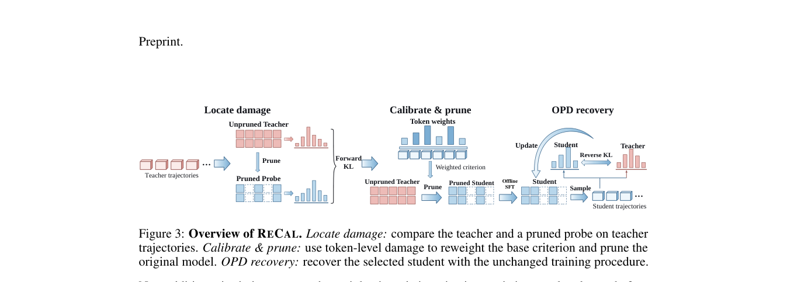

# ReCal: Calibrating Structured Pruning for On-Policy Distillation Recovery

<!-- source-sha256: e5f2aadc37cf03f67390a8ea6039809b81c27b5dedec645fe40a8d063c929af2 -->

[简体中文](README.md)

> Real FFN channel removal, teacher SFT, and student-trajectory OPD ran. A four-question diagnostic with negative results is not the paper benchmark.

## Paper information

| Field | Value |
| --- | --- |
| Paper | [ReCal: Calibrating Structured Pruning for On-Policy Distillation Recovery](https://arxiv.org/abs/2610.11332) |
| Affiliations | Zhongguancun Academy / Tencent / University of Science and Technology of China; first author Houcheng Jiang |
| First public release | 2026-10-08 (arXiv v1) |
| Authors' code | [Released](https://github.com/jianghoucheng/ReCal) |
| Adapter | `recal` |
| Local code | `src/auto_research/post_training/recal.py`; `scripts/run_recal_checkpoint.py` |

## Original paper

### Background and contribution

Pruning before distillation does not guarantee recovery: degraded student trajectories can limit OPD signal. ReCal measures teacher-trajectory damage with a pruned probe, then reweights calibration statistics from the original unpruned model and reselects channels. Keep width and recovery protocol fixed.


<!-- paper-figure:start -->
### Key figure from the paper

[](https://arxiv.org/pdf/2610.11332#page=5)

Reweight the unpruned model after measuring probe damage; do not select only from probe survivors. From the [paper](https://arxiv.org/abs/2610.11332); copyright belongs to the authors.
<!-- paper-figure:end -->

### Core equation and paper results

Damage is $D_{KL}(p_T\|p_{probe})$. Preserve teacher top 16 and the entire tail mass bucket, not renormalized top 16 alone. Normalize response damage weights to unit mass; use uniform weights at zero damage. Wanda-SP ranks channels by weight norm times weighted activation RMS.

The [paper](https://arxiv.org/html/2610.11332v1) reports up to 16.7 percentage points on AIME, not universal gains, and declines on IFBench. No live A/B.

## Local reproduction

Qwen3-4B/A100, physically reduce FFN width from 9728 to 7296. Both arms share width and teacher SFT responses, two SFT epochs and four OPD steps. Separate SFT and OPD questions; four validation items. See [run guide](../oct11-checkpoint-guide.md).

```bash
python scripts/run_recal_checkpoint.py --help
```

### Data and results

Truncated teacher generations fail rather than becoming incomplete targets; student inference does not see answers. [Phase metrics](metrics/checkpoint-a100-seed42.json) retain scores, nonzero gradients, and parameter displacements; see [GPU receipt](../../gpu-validations/recal-a100-20261011.json) for commands. Four correct answers do not establish stable ability.

### Code and boundaries

`prune_gated_ffn` removes rows from gate/up and columns from down, not dense zero masking. Recovery uses q/v LoRA, not original full-parameter FSDP, four domains, or multiple seeds. In the short run ReCal exact match fell from 1 to 0.75 after OPD; control stayed at 1. See [split correction and rerun audit](../../research-audits/oct11-runtime-audit.md). Retain the negative result; no Evolve integration.
